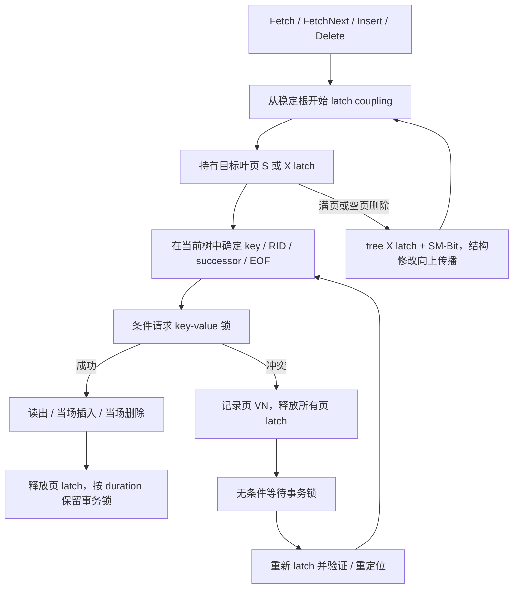

# ARIES/KVL 原文对照与内存实现

本次目标是按 Mohan 的 ARIES/KVL 原文重做叶层存储、遍历、锁协议与结构修改，替换原先“取邻接快照后由外部执行器加锁”的做法。此文档区分原文规定的协议、C++ 内存实现的选择，以及原文明示不涵盖的恢复功能。当前不是完整数据库产品，也没有做原文 TPS 复现。

## 1. 唯一协议依据

C. Mohan. **ARIES/KVL: A Key-Value Locking Method for Concurrency Control of Multiaction Transactions Operating on B-Tree Indexes**. VLDB 1990, pp. 392–405.

- 原始地址：https://www.vldb.org/conf/1990/P392.PDF
- 本分支副本：`papers/ARIES-KVL-VLDB1990.pdf`
- SHA-256：`22d20c5f30603c9835f80eba19255d81dcd7b9f7bd15a365d30af810dd3c6f45`
- 主要依据：§2.2、§4、§5.1–5.4，Figure 1、4–10。
- §3 的简单 S/X 算法是铺垫；本实现采用 §5 的 ARIES/KVL，不能把两者混为一谈。
- 本文没有 YCSB-E 实验或相应 TPS 曲线，不能承诺跑出“与原文相同”的 YCSB-E 数值或曲线。

## 2. 代码与物理叶页

- 公共接口：`include/index/aries_kvl.h`
- 独立实现：`src/index/aries_kvl.cpp`
- 交错、模型和并发测试：`test/aries_kvl_test.cpp`
- CMake 目标：`rrl_aries_kvl`、`rrl_aries_kvl_test`

这里的页是内存中的真实 B+ 树节点：有页号、VN、SM-Bit、页 latch、父节点指针，叶页还具有 PrevPage/NextPage。内部节点有 high keys 与 child pointers。根的身份保持不变。根溢出时先把旧根内容复制到新子页，再分裂这个复制页；复制页保留为左半页，根页改成指向左右子页的内部页。插入直接改变叶页内容，满页触发分裂；删除直接移除对应 key/RID，空叶页从树和叶链移除，并向上修改父节点。

非唯一索引叶页按 duplicate cluster 保存：每个叶页内一个 key 只占一个 key-map 项，其 RID/value 对按 RID 排序存放在该项的列表中；同一个 key 的 cluster 可以跨叶页，各页各有一项 key。游标保存叶页 VN、key-map slot 和 cluster 内 RID 序号，VN 未变时直接递增 RID 序号或 key-map slot。

**页 latch 保护物理结构；key-value 事务锁的持有状态仍位于独立锁管理器。** 原文也区分这两种对象，并没有要求把事务锁位嵌入叶页的某几个字节。关键是先在受 latch 保护的当前页中确定真实 key/successor，然后按协议请求锁；等待事务锁前释放所有页 latch，唤醒后重新验证。



## 3. 原文到代码、测试的对应

| 原文位置 | 协议行为 | 代码入口 | 验证 |
|---|---|---|---|
| §2.2、Figure 5 | parent S latch 保留至 child 获得 S/X latch；记录路径 VN，重走时从最深未变祖先继续；SMO 时等 POSC | `Impl::search`、`posc`、`Hold` | `vn_path_hint` 强制叶 VN 改变但内部祖先不变，验证从最深未变内部页继续；并发分裂、重复范围扫描；每事务同时页 latch 不超过 2 |
| Figure 6、§5.1 | 锁实际 satisfying key、next key 或 index 专属 EOF；S commit | `candidate`、`fetch_pair` | 负查找、普通 key 与 EOF 名称区分、EOF 阻塞尾部插入 |
| §5.1、Figure 4 | 条件失败后释放所有页 latch；S manual 等待；验证后保留 commit；失效临时锁释放 | `conditional`、`wait`、`fetch_pair`、`drop_temporary` | 前页插入更小候选，而第二页 VN 未变，读者仍须返回新候选 |
| §2.2、§5.2 | 每页 duplicate cluster 将 key 存一次并链接/列出 RID；保存 page/VN/key-map slot/RID ordinal；VN 未变直接推进；同 key 不重复加 S；等值结束例外 | `Page::Cluster`、`Index::open`、`next`、`Cursor` | 单页同 key 的游标保持 key slot、递增 RID ordinal；跨页重复 RID、同事务修改后的游标、等值扫描不锁下一不同 key 或 EOF |
| Figure 7、§5.3 | 已有非唯一 key 只取 IX commit，不请求 successor | `Impl::insert` | IX/IX 并发插入不同 RID；successor 已被 S 锁仍可添加重复实例 |
| Figure 7、§5.3 | 新 key 的 successor IX instant；原来 successor 持 S/SIX/X 时，当前 key X commit，否则 IX commit | `Impl::insert`、`Locks::request` | S、SIX、X 的锁状态复制；IX successor 不复制 X；unique 新键也不一律取 X |
| Figure 7 | unique 已存在值需要 S commit，再报告重复 | `Impl::insert` | 唯一键与相同 key/RID 重复检测 |
| Figure 8、§2.2 | split 完全向上传播之后重启 Insert；树 X、SM-Bit、稳定根；根内容复制到新 child 后分裂该 child | `split`、`split_root` | `root_copy_split` 检查复制页成为左半页且旧 root page id 保持不变；小页多层树、并发分裂、分裂后回滚 |
| Figure 9、§5.4 | 多实例自身 X commit、不锁 next；可能最后实例 next X commit；自身按条件 X instant/commit | `Impl::erase` | Figure 1 模式与期限矩阵、删除后读者等待、删除回滚 |
| Figure 10、§2.2 | 空叶真实 unlink；下层 latch 释放后再向上传播；根不换身份 | `delete_page` | 空页删除、删除全部后根回到单页、再次插入 |
| §6 | rollback 仅页 latch，不重新请求事务锁 | `abort`、事务析构、`undo=true` 分支 | 随机参考模型、读写交错中的物理 undo、只删除自己插入的 RID |

Instant 请求只检查当时兼容性，不建立新的持锁项；原先已经持有的锁不受影响。Manual 请求可在候选失效时恢复到原有锁状态，避免误释放此前的 commit 锁。Commit 锁在 commit 或全部 undo 完成之后释放。EOF 使用独立名称，`UINT64_MAX` 仍可作为普通 key。

## 4. 原文规定与本实现选择的边界

以下是当前原型与论文所述完整系统的边界，不代表把论文明确排除的功能列为 KVL 协议遗漏。

1. **纯内存页。** 没有 buffer pool、磁盘 fix/unfix 或 I/O。VN 是递增计数器。§2.2 明确允许 VN 使用计数器；“页”不意味着必须放在磁盘。
2. **key/RID 物理布局。** 当前已经按 §2.2 将每页重复 key 压成一个 `Cluster` key 项，并以独立 RID/value 列表承载同 key 的记录；同 key 可跨页，符合原文每页重复簇的组织方式。这里用定长 `idx_key_t` 与 C++ vector 表示 key-map/RID list，没有复现原系统变长 key 的 USI 字节偏移数组、页内 free-space 管理，也没有按真实字节数决定分裂。`order` 仍按逻辑 RID 条目数近似页容量，不能据此推断原系统的实际页占用或分裂频率。游标现在分别保存 key-map slot 与 RID ordinal。
3. **锁管理器。** 在线精确锁名由 `std::map` 管理，以一个 mutex/CV 协调；不存在固定 trace 的预注册坐标、区间切分或未来端点集合。原文提到通常使用 hash table，未给出其锁队列源代码。本实现的 map、唤醒策略、死锁检测和超时是工程选择，不能当作原文性能实现。
4. **重验证路径。** Search 记录从 root 到 leaf 的页指针和 VN。等待后若路径仍有效，代码在 tree S latch 保护下找到最深 VN 未变的内部祖先，从该祖先恢复 latch-coupled descent；第一个 VN 已变的节点改用当前页内 separator 搜索。第一叶 VN 不变时沿 Figure 6 快速返回；第二叶不会仅凭自己的 VN 未变直接返回，因此 Figure 4 的前页新候选仍会被检查。这个路径恢复减少重复 separator 搜索，但 C++ 原型仍使用固定指针路径，不是原文某个未公开系统实现的逐指令复刻。
5. **tree X 请求。** 普通条件成功时在原页 latch 下进入 SMO；若其他 SMO 已占用 tree latch，则先释放页 latch、等待 POSC，再重新搜索。这条失败回退用于避免本 C++ latch 实现中两个结构修改者分别占页、等待 tree/兄弟页的循环等待。Figure 8/10 将 tree X 简写为一个请求，本实现将失败路径显式化；不是伪代码逐指令翻译。
6. **页内存回收。** 从树中移除的页保留到索引析构，游标页号不会引用已释放内存；尚未引入安全并发回收机制。测试会验证树内已 unlink，并不等于已归还内存。
7. **恢复不属于本文给出的协议步骤。** 原文引言明确说 logging/recovery aspects 不在本文覆盖范围，并说明 ARIES/KVL 锁协议可与 WAL 或 shadow-page recovery 配合；§7 又将恢复细节指向 MoLe89。因此本分支不实现 WAL、LSN、持久化提交或崩溃恢复，这不是用本论文无法逐项对照的伪代码自行补造恢复算法。这里的事务 abort 仅为并发测试所需的内存 undo。
8. **单索引原型。** RID X 锁用于建模插删前已有数据记录锁的前提，锁名与 key 锁分离。目前没有跨索引共享的数据表管理器；Entry 的 value 是测试载荷，不是 System R 数据页实现。
9. **执行器。** 当前暴露直接事务/游标 API 和测试入口，尚未接入独立 YCSB-E 性能驱动；没有将旧 compact 执行器套到本实现上，也没有新画吞吐曲线。

因此准确称呼是：**按 ARIES/KVL 论文给出的并发控制与叶页组织算法实现的内存 B+ 树原型**。它没有复现原系统的字节级页格式、完整数据库产品或原文实验环境；论文未定义的 WAL/恢复由用户明确排除。

## 5. API 使用约束

- 同一 Transaction 同时只能由一个线程执行；不同事务可以并发。
- Index 必须比它的 Transaction 活得更久。
- 动作返回 Deadlock/Timeout 后，调用方应 abort，再从逻辑事务起点重试；不自动提交部分事务。
- `load`、`inspect`、`validate`、`height`、`set_observer` 只在没有并发事务操作时使用。Observer 安装后可被多个工作线程回调，需要线程安全，且不可重入 Index。
- `scan(start,end)` 为 `[start,end)`，按照范围锁规则保护停止边界。空区间直接返回。
- Delete 的原文前提是调用方指定待删的 key/RID，且底层数据记录已经受保护；不存在 key/RID 时返回 NotFound，不把它扩展成任意负谓词查询。

## 6. 在 .66 复核

工作区：`/home/dell/RdmaRangeLock-nextkey-paper-20261117`

分支：`codex/next-key-paper-20261117`

```bash
cmake -S . -B build-aries -DCMAKE_BUILD_TYPE=Debug
cmake --build build-aries --target rrl_aries_kvl_test -j 8
ctest --test-dir build-aries -R '^rrl_aries_kvl_test$' --output-on-failure
```

内存与未定义行为检查：

```bash
g++ -std=c++17 -O1 -g -fsanitize=address,undefined -fno-omit-frame-pointer -pthread -Iinclude src/index/aries_kvl.cpp test/aries_kvl_test.cpp -o build-aries/rrl_aries_kvl_asan
ASAN_OPTIONS=detect_leaks=1 timeout 120 build-aries/rrl_aries_kvl_asan
```

并发竞态检查：

```bash
g++ -std=c++17 -O1 -g -fsanitize=thread -pthread -Iinclude src/index/aries_kvl.cpp test/aries_kvl_test.cpp -o build-aries/rrl_aries_kvl_tsan
TSAN_OPTIONS=halt_on_error=1 timeout 120 build-aries/rrl_aries_kvl_tsan
```

最终证据位于 `reports/aries-kvl-20261117/`，包括源码 hash、编译日志、14 组测试、10 次整套重复、ASan/UBSan 和 TSan 日志。测试通过是当前实现的验证证据，不是协议正确性的形式化证明，也不能代替字节级页格式或性能复现。
