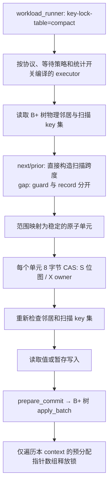

# 本地 next-key / gap / prior-key 专用 CAS 锁

实现分支：`codex/record2pl-compact-20261112`。使用已有 record CAS authority，但三个协议仍按各自的真实 B+ 树邻居生成保护范围；没有把范围锁降级为普通 record 锁。

## 执行路径与删除的开销



热路径绕过 `LockManager` / `IRangeLockManager`、通用锁表 mutex、已持有区间的冲突搜索、动态 holder 对象、全局事务 map。事务槽位和释放指针数组在测量前分配。next/prior 扫描直接生成连续跨度，省去逐行构造和合并请求；dense key 的坐标换算是直接算术，只有 sparse key 需要二分。

no-wait 使用本 context 的 generation 产生 owner token，不获取全局 age。wait-die / wound-wait 仍在每个新逻辑事务开始时获取一次全局递增 age，重试沿用 age；这提供算法需要的年龄顺序，不是全局事务 map。

启动 barrier 的 mutex、B+ 树自己的结构 latch、邻居重检和提交写回仍保留。邻居重检失败会正常中止并重试，避免并发结构修改后保护了过期的间隙。整体系统不是完全无锁。

## 空间与兼容关系

设预注册 key 数为 N，rank 从 0 开始：

| 协议 | 原子单元 | 锁状态空间 |
| --- | --- | --- |
| next-key / prior-key | key r 对应 `2r+1`，两侧 gap 对应偶数 | `8 × (2N+1)` 字节 |
| gap | record 空间 `[0,N)`；insert guard 空间 `[N,2N)` | `8 × 2N` 字节，空目录至少一个 word |

gap guard 获取 S；InsertIntent 获取该位置的 guard X 和 record X；普通 Record 只访问 record 空间。因此 guard 不阻止普通 record 操作，guard 之间共享，insert 与所覆盖的 guard 冲突。executor 的 gap guard 请求均为 S，专用接口拒绝其它 guard mode。

原子字沿用 record 编码：bit63 为 X 标志；S 时低 63 位是 context 0–62 的读者位图，X 时低位是 owner token。**第 64 个 context 的 S 保守编码成 X，会增加本来兼容的读之间的冲突**，包括 gap guard。64 线程数据包含这一代价，不能把它解释成与 generic 完全相同的冲突频率。1–63 个 context 的受支持请求经过参考兼容规则对照。

每个 context 状态仍按 64 字节对齐，避免 false sharing；释放列表是预分配的 `Word*` 数组，预算耗尽会中止并释放已获得的部分锁。每个单元 8 字节不等于整个范围只有 8 字节：范围覆盖 W 个单元时需要 O(W) 次获取/检查，宽范围与稀疏大 gap 可能很贵。

目录只保存连续 `[0,dense)` 的长度和其后的 sparse key。纯 dense key 域不需要逐 key 目录数组；锁状态和释放列表仍占空间。

## 当前专用范围

这是本地有限 key 域 benchmark 的实现。启动时注册初始 dense 域、preloaded 索引中的物理 key、trace 中的点 key 与范围端点。**注册仅创建锁坐标，不预先插入记录，也不提前决定冲突和调度**。插入后不需要迁移锁名，原锁的数值覆盖保持不变。

执行期间遇到未注册的 next/prior 端点或 insert key 会拒绝；当前不提供在线扩展无限 key 域。不要把这一条件隐藏为通用在线数据库的实现。超过 64 个 active contexts 或远程状态时，auto 回退 generic，显式 compact 拒绝配置。

## 使用与测量

```sh
build-record/rrl_workload_runner --index v2 --cc next-key \
  --key-lock-table compact --workload ycsb-e --keys 100000 \
  --txns 5000 --ops 10 --range 32 --zipf 0.99 --seed 7 \
  --threads 32 --execution-mode threads --wait-policy no-wait \
  --max-attempts 1000 --wait-timeout-ms 100 --warmup 1 --duration 3 \
  --format csv
```

`--cc` 可换为 `gap-lock` / `prior-key`；`--key-lock-table generic` 保留原实现作为对照。默认 auto 在支持的本地配置选择 compact。

`--key-latency 0 --key-statistics 0` 编译选择关闭细粒度延迟直方图、操作和 checksum 等计数的执行版本；提交、中止、重试、未完成数和错误仍统计。此模式的 rows/checksum 为 0，不能拿它与 full metrics 的这些列比较。禁止同时请求 latency histogram 和关闭 latency。

CSV 新增 `key_lock_table,key_lock_bytes,key_directory_bytes,key_state_bytes,key_held_capacity_bytes,key_latency,key_statistics`。generic 的这些空间列为 0 表示未测量，不能解释为 generic 不占空间。`lock_acquires` 计逻辑请求，next/prior 的合并跨度减少请求数；它不是 CAS 次数。compact 的 `rows_rechecked` 当前为 0，不表示省略了邻居/key 集重检。操作/行/checksum 计数包括已中止尝试，不等于已提交操作量。

`scripts/benchmark_compact_keys.py` 顺序运行三协议 × 三策略 × 1/8/32/64 线程 × 两后端 × 三轮，交错后端顺序，保留命令、原始 stdout/stderr、源码快照和 SHA256。主实验 full metrics、Zipf 0.99、每轮 warmup 1 秒、测量 3 秒。`scripts/summarize_compact_keys.py` 输出每组吞吐中位数、min/max、每提交中止/重试/等待及未完成数。

duration 模式重复同一份有限 trace，warmup 会填充部分初始 hole，后续 Insert 可能再次访问已存在 key。不同后端在相同时长内的推进量不同，因此不能声称主实验每次都是新 key 的物理插入。`scripts/benchmark_compact_key_supplement.py` 另外运行**无 warmup、无循环 duration 的一次性 uniform YCSB-E trace**，检查真实初始 hole 的填充行为，并单独对比 full / fast metrics。它不改变主实验的算法、trace 或重试规则。

这里的 YCSB-E 是项目已有变体：每事务 10 次操作，约 95% 数值区间扫描、5% Insert；扫描宽度是 key 区间宽度，不是保证返回固定行数。Zipf 作用于有序 key，热点范围会重叠，不能直接等同于官方 YCSB 的全部生成细节。

## 正确性验证

- 30,000 组专用锁表与 `RangeLock::conflicts` 的随机兼容性对照，覆盖开闭/无界端点与 UINT64_MAX。
- 三协议的 wait-die / wound-wait 等待和伤害处理、范围 guard 阻止插入、释放后插入成功。
- generic / compact 的单事务混合 scan、insert、delete、重插入、读自己写、UINT64_MAX 与 B+ 树 split 对照。
- YCSB-E runner 覆盖三策略、4/64 线程、协程、warmup、duration、锁预算清理、65-context 拒绝/回退和 metrics-off。
- 相关 record、通用策略、own-write、scan-batch、邻居、B+ 树和 runner 配置回归。基准实验还检查错误及逻辑事务记账一致性；这些检查不能替代完整的形式化可串行化证明。
