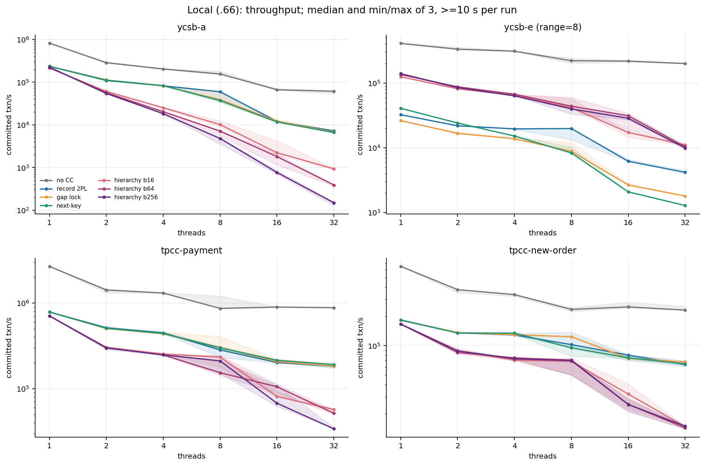
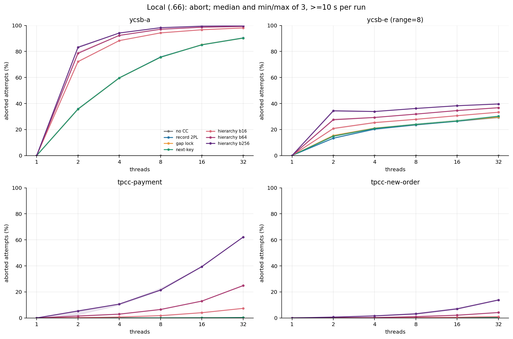
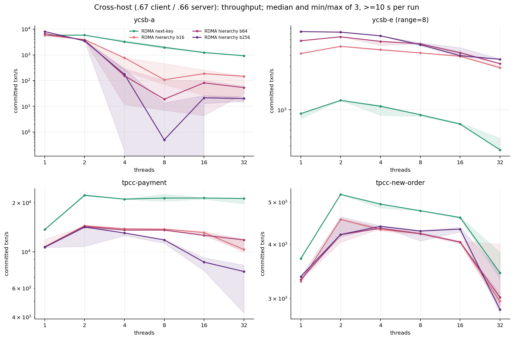
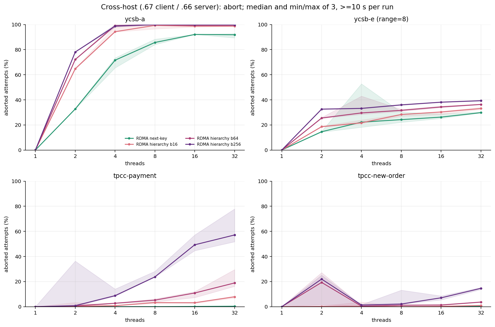
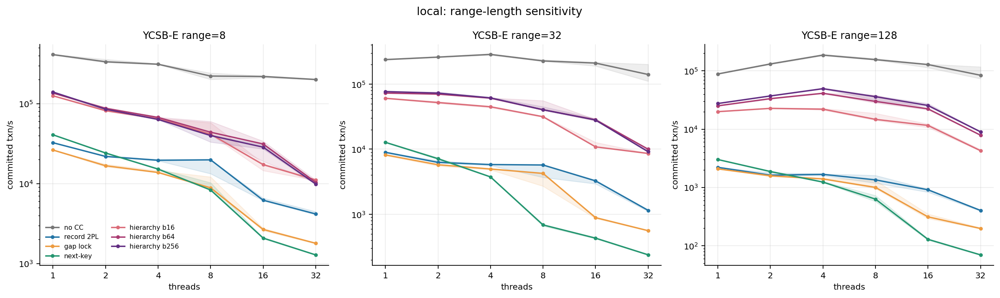
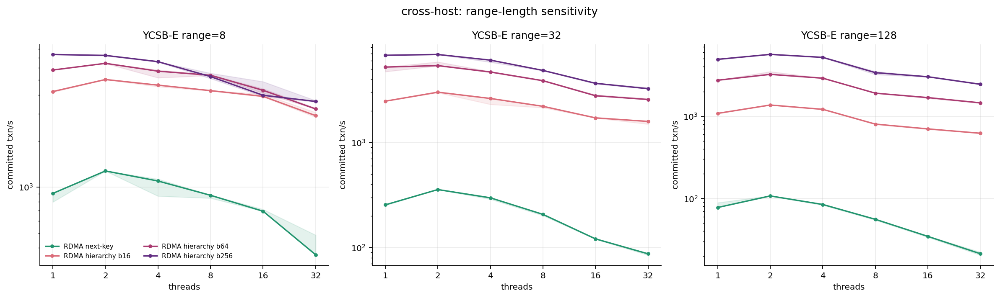
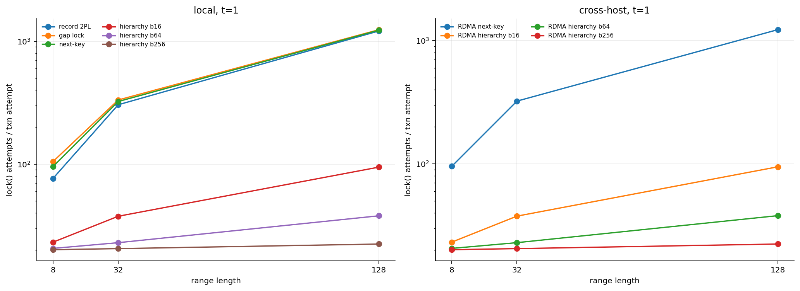
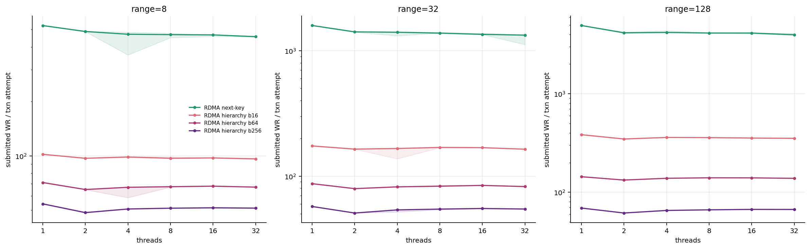
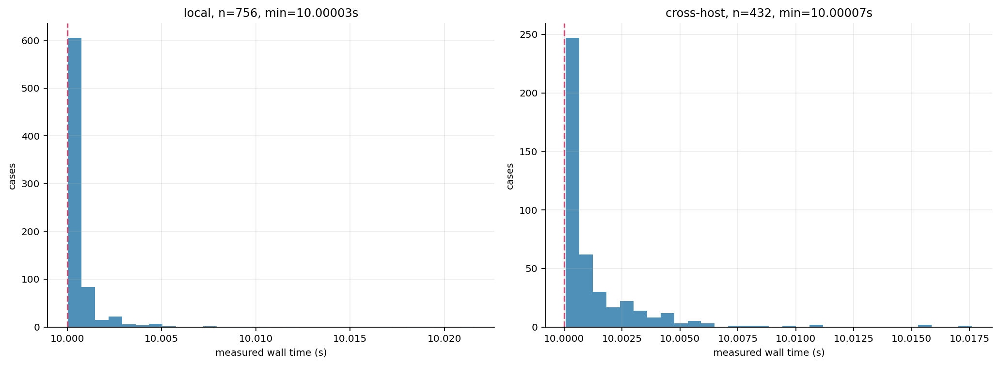
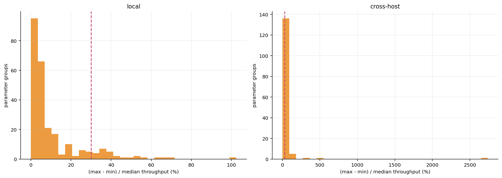

# 新代码正式矩阵报告（2026-11-02）

测量源码提交：ee1d106889268ea310ff9dd54c053762fd750113；C++ 实现基线为 596c94f，此后测量提交只增加运行配置与验收脚本。

配置：experiments/configs/formal_both_10s_20261102.json；原始 manifest：verified-campaign-20261102-113536.json。

运行开始 2026-11-02T11:35:36.493060；结束 2026-11-02T15:00:33.803962（.66 主机本地时钟）。

两端同源码 Release；mlx5_0 / GID=3；.66=10.0.0.3 server，.67=10.0.0.4 client；本地矩阵在 .66。

每 case >=10 秒，三次，seed=8/9/10；10,000 keys，trace 5,000 transactions 循环，10 ops/txn，Zipf=0.99，TPC-C items=5。

profile=0；linear；local gate=1；gate retry=64；RDMA QP=min(threads,2)。范围 8/32/128，线程 1/2/4/8/16/32，bucket 16/64/256。

## 数据验收

| 矩阵 | case | 参数组 | elapsed 最短/最长（秒） | 硬错误 | 容量中止 | gate 中止 |
|---|---:|---:|---:|---:|---:|---:|
| local | 756 | 252 | 10.00003 / 10.02158 | 0 | 0 | 0 |
| cross-host | 432 | 144 | 10.00007 / 10.01761 | 0 | 0 | 0 |

全部预期参数组合、run/seed、唯一性、三次重复、CSV 列宽、事务守恒及 profile 关闭均通过检查。

硬件 CTest 24/24、跨主机定向 3/3、16 点十秒容量预检先于正式矩阵完成；实验顺序执行，不并行争用 .66。

## 图表与解释

本地：成功事务吞吐，曲线为每点三次的中位数，阴影为最小—最大；层级锁三个 bucket 均展示。

本地：中止率，曲线为每点三次的中位数，阴影为最小—最大；层级锁三个 bucket 均展示。

跨主机：成功事务吞吐，曲线为每点三次的中位数，阴影为最小—最大；层级锁三个 bucket 均展示。

跨主机：中止率，曲线为每点三次的中位数，阴影为最小—最大；层级锁三个 bucket 均展示。

YCSB-E 的 range=8/32/128 扩展性，避免只挑短范围结果。

YCSB-E 的 range=8/32/128 扩展性，避免只挑短范围结果。

锁请求次数/尝试事务，t=1；这是调用强度，不等于峰值同时持锁数。

RDMA WR/尝试事务；profile 关闭时没有同步提交与排队计时，不能把 WR 数当 RTT。

所有 case 的真实 elapsed 分布；10 秒结束后包含完成/中止当前事务与释放锁的时间。

重复点波动；seed 也随 run 改变，三次不是纯计时噪声重复，不能据此构造严谨置信区间。

## 主要测量发现

本地 YCSB-A 的 none 基线：t1=825,941、t32=61,350 txn/s（0.074×）；该路径中止为零，扩展性下降不能归因于事务锁中止，需单独定位索引/共享资源争用。

local / YCSB-A / record-2pl / t32：成功吞吐 7,221.2 txn/s，中止率 90.36%；热点 no-wait 结果要同时看提交与尝试吞吐，不能仅用 attempts 衡量收益。

local / YCSB-A / gap-lock / t32：成功吞吐 6,817.6 txn/s，中止率 90.28%；热点 no-wait 结果要同时看提交与尝试吞吐，不能仅用 attempts 衡量收益。

local / YCSB-A / next-key / t32：成功吞吐 6,635.1 txn/s，中止率 90.33%；热点 no-wait 结果要同时看提交与尝试吞吐，不能仅用 attempts 衡量收益。

local / YCSB-A / hierarchical b16 / t32：成功吞吐 931.5 txn/s，中止率 98.10%；热点 no-wait 结果要同时看提交与尝试吞吐，不能仅用 attempts 衡量收益。

cross-host / YCSB-A / rdma-next-key / t32：成功吞吐 923.6 txn/s，中止率 91.89%；热点 no-wait 结果要同时看提交与尝试吞吐，不能仅用 attempts 衡量收益。

cross-host / YCSB-A / rdma-hierarchical b16 / t32：成功吞吐 147.2 txn/s，中止率 98.76%；热点 no-wait 结果要同时看提交与尝试吞吐，不能仅用 attempts 衡量收益。

## 成功吞吐数表

所有单元格为中位数 [最小值, 最大值]，单位 committed txn/s。

### local / ycsb-a / range=0

| 协议 / bucket | t1 | t2 | t4 | t8 | t16 | t32 |
|---|---:|---:|---:|---:|---:|---:|
| none | 825,941.0 [825,224.0, 825,943.0] | 287,469.0 [281,103.0, 299,841.0] | 204,876.0 [198,157.0, 205,009.0] | 156,302.0 [150,822.0, 181,358.0] | 66,739.3 [65,539.9, 70,597.6] | 61,349.8 [52,782.1, 63,619.0] |
| record-2pl | 236,755.0 [231,323.0, 237,048.0] | 109,797.0 [108,953.0, 110,865.0] | 82,261.5 [80,343.4, 82,656.2] | 59,721.1 [39,781.3, 60,815.4] | 12,099.7 [11,589.4, 12,166.8] | 7,221.2 [7,148.4, 7,291.3] |
| gap-lock | 237,246.0 [235,632.0, 237,315.0] | 113,291.0 [111,599.0, 114,163.0] | 81,805.0 [81,723.1, 81,960.4] | 38,952.7 [38,324.9, 57,099.0] | 12,287.4 [11,565.1, 12,973.0] | 6,817.6 [6,564.5, 6,848.2] |
| next-key | 236,832.0 [236,405.0, 236,900.0] | 111,470.0 [110,070.0, 112,502.0] | 83,405.6 [82,731.5, 84,035.7] | 36,940.3 [33,544.4, 40,251.9] | 11,697.7 [11,368.9, 11,884.6] | 6,635.1 [6,358.4, 6,722.9] |
| hierarchical / 16 | 216,120.0 [215,648.0, 216,442.0] | 60,807.9 [58,377.6, 61,696.6] | 25,202.9 [24,353.7, 26,049.6] | 10,146.8 [8,932.1, 12,475.9] | 2,222.5 [1,957.3, 4,234.2] | 931.5 [874.4, 950.3] |
| hierarchical / 64 | 220,513.0 [220,175.0, 220,598.0] | 56,707.5 [56,561.5, 57,055.3] | 20,333.9 [20,116.9, 20,971.8] | 7,125.4 [5,474.9, 7,393.6] | 1,800.0 [1,146.3, 2,090.1] | 387.9 [363.8, 400.1] |
| hierarchical / 256 | 226,221.0 [226,205.0, 226,434.0] | 54,470.6 [53,508.2, 55,891.3] | 18,281.1 [18,146.9, 18,933.1] | 4,792.1 [3,542.5, 4,952.4] | 763.0 [696.5, 846.0] | 148.5 [127.0, 157.8] |

### local / ycsb-e / range=8

| 协议 / bucket | t1 | t2 | t4 | t8 | t16 | t32 |
|---|---:|---:|---:|---:|---:|---:|
| none | 410,740.0 [405,435.0, 414,401.0] | 334,185.0 [327,011.0, 358,438.0] | 311,252.0 [309,808.0, 316,460.0] | 221,344.0 [201,115.0, 241,507.0] | 218,838.0 [211,667.0, 222,924.0] | 200,411.0 [199,764.0, 204,370.0] |
| record-2pl | 32,462.8 [32,266.8, 32,617.3] | 21,854.2 [21,853.3, 22,348.7] | 19,580.8 [19,330.3, 20,051.5] | 19,828.5 [13,295.9, 19,895.9] | 6,195.3 [6,118.2, 6,579.8] | 4,169.3 [4,084.8, 4,466.7] |
| gap-lock | 26,293.1 [26,236.4, 26,377.7] | 16,726.8 [16,207.4, 17,494.4] | 13,775.2 [13,690.3, 14,512.1] | 8,845.8 [8,649.4, 12,133.5] | 2,668.4 [2,582.8, 2,760.0] | 1,792.7 [1,769.5, 1,807.5] |
| next-key | 40,757.5 [40,718.2, 40,810.8] | 24,148.6 [23,920.8, 24,487.1] | 15,187.1 [15,130.9, 15,413.7] | 8,319.6 [8,210.6, 10,262.1] | 2,082.3 [2,046.6, 2,084.8] | 1,282.2 [1,274.0, 1,291.0] |
| hierarchical / 16 | 125,372.0 [124,900.0, 125,820.0] | 81,670.6 [80,870.5, 85,522.9] | 64,780.1 [64,330.2, 65,597.6] | 41,528.6 [41,017.9, 57,788.1] | 17,256.5 [14,547.6, 17,977.5] | 11,121.7 [10,958.9, 11,146.0] |
| hierarchical / 64 | 135,597.0 [134,855.0, 135,843.0] | 87,386.4 [87,175.5, 89,926.2] | 67,317.8 [65,738.5, 67,650.5] | 43,906.6 [41,275.3, 59,908.6] | 31,292.1 [18,997.6, 33,910.8] | 10,384.4 [10,259.3, 11,084.0] |
| hierarchical / 256 | 139,832.0 [139,389.0, 139,998.0] | 85,276.8 [81,915.8, 88,164.5] | 63,431.7 [63,311.7, 66,508.1] | 39,912.3 [33,074.9, 40,925.5] | 28,579.1 [27,136.3, 30,489.7] | 9,883.3 [9,743.5, 10,342.2] |

### local / ycsb-e / range=32

| 协议 / bucket | t1 | t2 | t4 | t8 | t16 | t32 |
|---|---:|---:|---:|---:|---:|---:|
| none | 238,226.0 [235,385.0, 239,386.0] | 259,789.0 [259,517.0, 264,986.0] | 286,271.0 [278,539.0, 287,176.0] | 226,946.0 [225,211.0, 237,279.0] | 210,585.0 [189,937.0, 216,577.0] | 140,616.0 [110,969.0, 201,583.0] |
| record-2pl | 8,972.3 [8,722.3, 8,978.7] | 6,276.5 [6,182.9, 6,664.4] | 5,811.8 [5,619.2, 5,851.7] | 5,721.8 [3,699.0, 5,784.9] | 3,261.2 [2,943.1, 3,348.3] | 1,150.5 [1,108.1, 1,173.4] |
| gap-lock | 8,174.6 [8,027.5, 8,180.3] | 5,777.2 [5,529.4, 5,876.7] | 4,965.1 [4,826.9, 5,009.0] | 4,248.6 [2,706.0, 4,318.5] | 888.7 [863.6, 899.2] | 560.2 [559.1, 563.7] |
| next-key | 12,765.2 [12,638.1, 12,800.3] | 7,149.8 [6,972.9, 7,390.2] | 3,753.1 [3,727.6, 3,776.2] | 687.1 [659.9, 700.0] | 430.3 [421.9, 437.1] | 238.7 [235.9, 239.4] |
| hierarchical / 16 | 60,564.9 [60,433.9, 60,575.5] | 52,105.5 [50,744.1, 54,029.1] | 44,872.3 [43,594.5, 45,622.3] | 31,587.2 [31,045.5, 31,989.9] | 10,862.4 [10,821.7, 12,761.8] | 8,612.3 [8,552.8, 8,660.2] |
| hierarchical / 64 | 72,922.1 [72,350.7, 73,339.1] | 70,220.5 [69,917.4, 70,990.2] | 60,948.1 [60,579.8, 61,361.8] | 40,440.7 [39,824.6, 55,730.6] | 28,329.5 [27,208.7, 28,749.4] | 10,004.1 [9,971.5, 10,039.7] |
| hierarchical / 256 | 76,862.1 [75,120.9, 77,027.1] | 72,801.1 [71,549.9, 75,828.8] | 61,454.0 [60,771.9, 62,996.0] | 40,364.8 [39,831.1, 45,033.2] | 28,026.4 [28,023.1, 29,589.8] | 9,152.5 [9,042.0, 9,561.3] |

### local / ycsb-e / range=128

| 协议 / bucket | t1 | t2 | t4 | t8 | t16 | t32 |
|---|---:|---:|---:|---:|---:|---:|
| none | 88,258.3 [87,864.4, 90,185.1] | 131,150.0 [128,841.0, 133,389.0] | 185,920.0 [182,304.0, 191,898.0] | 155,451.0 [154,232.0, 162,995.0] | 128,068.0 [113,289.0, 130,252.0] | 83,924.9 [73,308.4, 117,030.0] |
| record-2pl | 2,215.5 [2,207.0, 2,217.1] | 1,624.6 [1,611.2, 1,791.4] | 1,677.7 [1,593.4, 1,716.3] | 1,349.9 [1,192.4, 1,611.0] | 913.0 [831.6, 937.8] | 403.8 [393.9, 410.3] |
| gap-lock | 2,083.2 [2,082.8, 2,083.5] | 1,584.7 [1,545.5, 1,659.6] | 1,400.2 [1,392.7, 1,449.2] | 1,003.0 [958.9, 1,322.7] | 313.4 [292.7, 350.8] | 197.9 [196.6, 203.9] |
| next-key | 3,013.9 [3,011.3, 3,015.3] | 1,876.8 [1,843.8, 1,911.9] | 1,236.6 [1,228.2, 1,275.3] | 631.6 [575.3, 728.5] | 129.1 [125.3, 131.3] | 69.9 [69.2, 70.6] |
| hierarchical / 16 | 19,944.1 [19,926.1, 19,977.0] | 22,695.1 [22,637.3, 23,023.6] | 22,008.1 [21,297.8, 22,689.2] | 14,708.1 [14,164.1, 18,674.6] | 11,580.5 [10,692.5, 12,286.6] | 4,272.9 [4,202.0, 4,495.6] |
| hierarchical / 64 | 25,094.3 [24,976.9, 25,156.2] | 33,337.4 [32,734.8, 33,442.7] | 41,164.5 [41,113.8, 41,479.8] | 29,861.1 [28,121.0, 38,451.4] | 22,273.5 [21,512.1, 22,558.1] | 7,879.5 [7,859.4, 7,975.6] |
| hierarchical / 256 | 27,510.9 [27,496.0, 27,533.4] | 37,069.0 [37,051.0, 37,100.2] | 49,372.8 [49,140.1, 50,968.2] | 36,020.3 [31,150.3, 37,375.5] | 25,480.9 [24,472.0, 27,583.4] | 8,993.8 [8,938.7, 9,067.6] |

### local / tpcc-payment / range=0

| 协议 / bucket | t1 | t2 | t4 | t8 | t16 | t32 |
|---|---:|---:|---:|---:|---:|---:|
| none | 2,680,890.0 [2,680,320.0, 2,683,400.0] | 1,420,640.0 [1,315,030.0, 1,463,600.0] | 1,308,140.0 [1,305,820.0, 1,324,750.0] | 865,295.0 [859,876.0, 1,206,960.0] | 897,290.0 [889,300.0, 901,741.0] | 881,724.0 [878,920.0, 891,797.0] |
| record-2pl | 785,308.0 [779,426.0, 786,110.0] | 513,880.0 [509,338.0, 531,548.0] | 448,786.0 [442,809.0, 452,679.0] | 282,798.0 [231,504.0, 304,582.0] | 201,986.0 [198,437.0, 212,003.0] | 182,395.0 [179,228.0, 184,108.0] |
| gap-lock | 786,083.0 [785,684.0, 786,155.0] | 504,177.0 [503,328.0, 513,382.0] | 437,785.0 [428,499.0, 459,615.0] | 302,560.0 [292,887.0, 405,743.0] | 206,829.0 [198,619.0, 221,384.0] | 183,374.0 [182,546.0, 198,037.0] |
| next-key | 785,791.0 [773,164.0, 785,795.0] | 507,942.0 [496,156.0, 513,692.0] | 441,170.0 [437,782.0, 460,036.0] | 299,070.0 [285,032.0, 311,302.0] | 214,426.0 [207,922.0, 218,526.0] | 190,447.0 [172,222.0, 194,497.0] |
| hierarchical / 16 | 705,460.0 [700,770.0, 706,101.0] | 303,762.0 [293,795.0, 304,401.0] | 253,110.0 [253,003.0, 261,575.0] | 233,467.0 [177,489.0, 238,726.0] | 81,051.1 [80,062.4, 91,965.7] | 56,978.9 [55,230.7, 58,861.0] |
| hierarchical / 64 | 707,490.0 [702,347.0, 707,840.0] | 300,698.0 [298,047.0, 309,760.0] | 247,550.0 [246,957.0, 254,265.0] | 153,374.0 [142,425.0, 242,796.0] | 105,185.0 [88,650.2, 112,987.0] | 51,506.0 [50,036.4, 55,695.0] |
| hierarchical / 256 | 707,275.0 [705,832.0, 711,307.0] | 298,400.0 [285,752.0, 303,164.0] | 247,480.0 [243,680.0, 250,215.0] | 210,608.0 [150,258.0, 213,405.0] | 67,499.3 [61,952.6, 109,395.0] | 33,878.9 [33,833.8, 35,193.7] |

### local / tpcc-new-order / range=0

| 协议 / bucket | t1 | t2 | t4 | t8 | t16 | t32 |
|---|---:|---:|---:|---:|---:|---:|
| none | 651,327.0 [649,678.0, 651,341.0] | 376,018.0 [350,258.0, 376,271.0] | 334,138.0 [321,556.0, 335,657.0] | 235,613.0 [223,989.0, 245,997.0] | 249,950.0 [244,832.0, 280,483.0] | 231,796.0 [230,555.0, 252,838.0] |
| record-2pl | 182,654.0 [181,496.0, 182,788.0] | 135,637.0 [134,457.0, 136,826.0] | 128,789.0 [128,277.0, 134,063.0] | 102,661.0 [94,978.9, 137,211.0] | 80,059.7 [70,364.7, 81,193.2] | 64,179.6 [61,727.1, 70,013.0] |
| gap-lock | 183,786.0 [183,388.0, 183,807.0] | 136,383.0 [136,332.0, 139,271.0] | 129,779.0 [127,550.0, 131,889.0] | 123,608.0 [122,088.0, 124,523.0] | 74,319.3 [71,775.0, 79,997.9] | 68,139.4 [65,047.7, 68,317.6] |
| next-key | 183,742.0 [183,469.0, 183,819.0] | 135,039.0 [134,553.0, 137,096.0] | 134,717.0 [130,045.0, 134,739.0] | 95,004.8 [77,724.6, 100,553.0] | 75,141.1 [73,680.5, 78,342.1] | 65,144.1 [62,740.6, 67,460.3] |
| hierarchical / 16 | 166,028.0 [166,009.0, 166,335.0] | 89,168.4 [85,062.3, 94,448.9] | 71,003.0 [69,308.3, 71,957.6] | 68,987.7 [50,167.1, 75,103.2] | 31,906.6 [22,682.3, 40,575.4] | 14,852.3 [14,636.7, 15,039.1] |
| hierarchical / 64 | 166,449.0 [166,120.0, 166,529.0] | 85,172.7 [82,173.5, 90,610.6] | 75,073.6 [72,099.9, 75,458.5] | 71,182.5 [49,694.6, 72,035.6] | 25,039.9 [21,577.0, 28,720.2] | 14,356.8 [14,033.2, 14,898.8] |
| hierarchical / 256 | 166,832.0 [166,662.0, 167,052.0] | 88,463.8 [86,322.5, 90,502.0] | 73,293.5 [71,889.4, 74,678.8] | 70,311.0 [50,283.5, 72,993.1] | 24,941.6 [20,949.5, 28,443.3] | 14,979.0 [14,057.9, 15,006.7] |

### cross-host / ycsb-a / range=0

| 协议 / bucket | t1 | t2 | t4 | t8 | t16 | t32 |
|---|---:|---:|---:|---:|---:|---:|
| rdma-next-key | 5,768.5 [5,757.1, 5,774.3] | 5,856.6 [5,831.3, 5,859.0] | 3,222.6 [3,124.1, 3,669.5] | 1,961.5 [1,761.1, 2,121.8] | 1,239.7 [1,199.0, 1,245.1] | 923.6 [922.1, 963.5] |
| rdma-hierarchical / 16 | 5,796.9 [5,796.0, 5,812.6] | 3,935.6 [3,908.9, 3,966.5] | 770.0 [236.9, 785.2] | 108.6 [71.3, 463.9] | 186.4 [26.9, 257.1] | 147.2 [15.2, 151.6] |
| rdma-hierarchical / 64 | 6,716.5 [6,693.2, 6,735.2] | 3,748.0 [3,719.6, 3,758.1] | 155.3 [11.8, 293.5] | 19.1 [7.1, 102.7] | 81.8 [4.4, 100.7] | 53.5 [30.7, 62.2] |
| rdma-hierarchical / 256 | 8,082.1 [8,037.0, 8,125.1] | 3,493.0 [3,459.0, 3,494.2] | 177.2 [0.2, 284.9] | 0.5 [0.0, 13.7] | 21.5 [12.7, 25.9] | 20.2 [15.2, 23.5] |

### cross-host / ycsb-e / range=8

| 协议 / bucket | t1 | t2 | t4 | t8 | t16 | t32 |
|---|---:|---:|---:|---:|---:|---:|
| rdma-next-key | 907.3 [797.3, 909.6] | 1,272.3 [1,271.5, 1,274.0] | 1,093.4 [871.0, 1,124.9] | 881.5 [844.7, 885.8] | 693.5 [692.7, 713.1] | 360.1 [357.9, 484.1] |
| rdma-hierarchical / 16 | 4,207.8 [4,167.9, 4,224.9] | 5,042.5 [5,036.7, 5,068.4] | 4,632.5 [4,527.8, 4,660.6] | 4,264.7 [4,248.2, 4,270.9] | 3,912.9 [3,884.5, 4,049.8] | 2,927.7 [2,858.6, 3,070.5] |
| rdma-hierarchical / 64 | 5,818.7 [5,806.2, 5,830.9] | 6,433.5 [6,423.1, 6,436.1] | 5,718.5 [5,177.4, 5,825.3] | 5,376.7 [5,361.6, 5,415.6] | 4,286.1 [4,111.0, 4,394.6] | 3,238.1 [3,232.5, 3,278.7] |
| rdma-hierarchical / 256 | 7,348.4 [7,346.1, 7,372.3] | 7,249.4 [7,208.2, 7,287.1] | 6,598.9 [6,556.8, 6,601.0] | 5,271.0 [5,116.1, 5,545.6] | 3,977.2 [3,910.4, 4,883.7] | 3,624.9 [3,595.5, 3,671.7] |

### cross-host / ycsb-e / range=32

| 协议 / bucket | t1 | t2 | t4 | t8 | t16 | t32 |
|---|---:|---:|---:|---:|---:|---:|
| rdma-next-key | 254.8 [252.2, 255.1] | 356.1 [355.9, 358.9] | 297.2 [288.5, 300.3] | 206.9 [201.8, 206.9] | 121.0 [120.2, 122.2] | 87.2 [84.7, 87.8] |
| rdma-hierarchical / 16 | 2,466.1 [2,464.9, 2,479.7] | 3,003.5 [2,971.9, 3,003.8] | 2,617.5 [2,299.3, 2,634.5] | 2,204.7 [2,140.4, 2,205.6] | 1,711.3 [1,705.2, 1,718.2] | 1,583.2 [1,492.4, 1,599.9] |
| rdma-hierarchical / 64 | 5,204.4 [4,711.2, 5,207.4] | 5,372.9 [5,341.5, 5,831.3] | 4,672.2 [4,639.2, 4,722.8] | 3,864.9 [3,826.3, 3,866.2] | 2,779.1 [2,775.3, 2,839.5] | 2,558.8 [2,558.6, 2,612.8] |
| rdma-hierarchical / 256 | 6,741.3 [6,709.6, 6,818.6] | 6,854.5 [6,850.2, 6,884.6] | 6,060.5 [5,793.4, 6,085.1] | 4,838.1 [4,809.6, 4,856.5] | 3,647.4 [3,601.9, 3,651.5] | 3,242.5 [3,233.6, 3,328.2] |

### cross-host / ycsb-e / range=128

| 协议 / bucket | t1 | t2 | t4 | t8 | t16 | t32 |
|---|---:|---:|---:|---:|---:|---:|
| rdma-next-key | 77.7 [77.6, 88.9] | 107.4 [106.8, 107.9] | 84.5 [82.9, 85.1] | 55.8 [54.6, 56.1] | 34.6 [33.8, 34.9] | 21.3 [20.5, 22.3] |
| rdma-hierarchical / 16 | 1,083.8 [1,077.2, 1,089.2] | 1,369.4 [1,368.2, 1,373.5] | 1,213.1 [1,206.9, 1,222.5] | 802.5 [793.5, 803.6] | 701.6 [693.6, 702.4] | 620.8 [618.1, 621.3] |
| rdma-hierarchical / 64 | 2,743.0 [2,718.4, 2,745.1] | 3,231.0 [3,220.6, 3,496.3] | 2,903.2 [2,888.8, 2,907.4] | 1,907.4 [1,906.7, 1,912.9] | 1,685.7 [1,655.6, 1,688.3] | 1,455.3 [1,441.7, 1,459.6] |
| rdma-hierarchical / 256 | 4,921.1 [4,881.1, 4,937.3] | 5,653.7 [5,639.0, 5,667.0] | 5,197.1 [5,168.4, 5,253.7] | 3,391.4 [3,217.6, 3,511.8] | 3,022.0 [2,998.7, 3,027.7] | 2,447.3 [2,422.2, 2,482.6] |

### cross-host / tpcc-payment / range=0

| 协议 / bucket | t1 | t2 | t4 | t8 | t16 | t32 |
|---|---:|---:|---:|---:|---:|---:|
| rdma-next-key | 13,675.3 [13,612.4, 13,720.5] | 22,144.0 [21,941.9, 22,424.8] | 20,982.1 [20,940.7, 20,995.6] | 21,304.7 [20,402.0, 22,448.2] | 21,316.4 [20,985.2, 21,321.0] | 21,180.2 [19,658.0, 21,294.7] |
| rdma-hierarchical / 16 | 10,750.2 [10,693.9, 11,885.7] | 14,441.4 [14,233.4, 14,454.2] | 13,828.9 [13,585.3, 13,924.1] | 13,758.2 [13,699.2, 13,831.0] | 13,111.6 [13,059.8, 13,371.3] | 10,340.2 [9,888.9, 11,875.1] |
| rdma-hierarchical / 64 | 10,705.8 [10,635.2, 10,751.5] | 14,287.0 [14,032.9, 14,396.3] | 13,578.9 [13,499.4, 13,708.5] | 13,577.1 [13,524.0, 13,606.3] | 12,623.8 [12,495.7, 12,921.9] | 11,817.8 [10,160.4, 12,002.6] |
| rdma-hierarchical / 256 | 10,660.2 [10,639.2, 10,751.9] | 14,163.8 [10,793.3, 14,493.7] | 13,041.6 [12,561.4, 13,043.7] | 11,828.5 [11,286.3, 11,868.3] | 8,652.4 [7,663.9, 9,212.5] | 7,585.0 [4,235.6, 8,289.1] |

### cross-host / tpcc-new-order / range=0

| 协议 / bucket | t1 | t2 | t4 | t8 | t16 | t32 |
|---|---:|---:|---:|---:|---:|---:|
| rdma-next-key | 3,708.7 [3,693.2, 3,716.7] | 5,206.7 [5,204.6, 5,210.9] | 4,948.1 [4,851.1, 4,959.9] | 4,776.2 [4,770.9, 4,776.4] | 4,609.2 [4,585.8, 4,620.5] | 3,436.9 [3,329.6, 3,825.7] |
| rdma-hierarchical / 16 | 3,283.9 [3,282.0, 3,295.7] | 4,563.4 [4,555.1, 4,594.2] | 4,324.0 [4,283.1, 4,368.1] | 4,230.3 [4,209.1, 4,253.3] | 4,043.7 [4,000.2, 4,064.6] | 2,955.8 [2,857.3, 4,002.4] |
| rdma-hierarchical / 64 | 3,316.3 [3,307.2, 3,318.2] | 4,207.6 [4,041.2, 4,551.0] | 4,351.8 [4,346.3, 4,368.9] | 4,229.0 [4,226.1, 4,256.5] | 4,044.4 [4,027.4, 4,065.6] | 3,017.8 [2,885.0, 3,062.9] |
| rdma-hierarchical / 256 | 3,368.6 [3,352.7, 3,374.4] | 4,211.5 [4,155.1, 4,622.3] | 4,396.8 [4,393.3, 4,413.7] | 4,287.9 [4,068.0, 4,306.5] | 4,334.3 [4,272.2, 4,371.3] | 2,828.3 [2,778.3, 3,447.9] |

## 中止构成与测量边界

| 矩阵 / 协议 | 尝试事务 | 中止 | conflict | capacity | gate | 其余中止 |
|---|---:|---:|---:|---:|---:|---:|
| local / none | 470,817,536 | 0 | 0 | 0 | 0 | 0 |
| local / record-2pl | 128,076,045 | 15,523,298 | 15,522,166 | 0 | 0 | 1,132 |
| local / gap-lock | 127,778,408 | 14,384,038 | 14,382,907 | 0 | 0 | 1,131 |
| local / next-key | 125,291,636 | 13,478,695 | 13,477,565 | 0 | 0 | 1,130 |
| local / hierarchical | 387,761,727 | 108,276,879 | 108,273,488 | 0 | 0 | 3,391 |
| cross-host / rdma-next-key | 6,671,862 | 1,488,301 | 1,487,165 | 0 | 0 | 1,136 |
| cross-host / rdma-hierarchical | 25,624,620 | 9,894,760 | 9,891,373 | 0 | 0 | 3,387 |

其余中止包括窗口结束、扫描后验证等没有独立列的路径，不能全部解释成逻辑锁冲突。总数只作核账；不同点尝试次数差异很大，性能比较使用逐点比率。

## 发现的问题与建议顺序

1. 44/396 个参数组的 (max−min)/median >30%；应先复测这些点，不能只取最好一次。

2. 优先定位本地无事务锁的索引扩展性：分别测 update、insert/delete，加入根/结构写路径与 latch 等待的定向采样；本矩阵没有这些计时，不能断定某一把 latch 是唯一原因。

3. 再分析热点下 no-wait 的中止与浪费：固定 Zipf、bucket、线程做单变量对照，保留原隔离和提交后释放时机，不通过增添 sleep 掩盖冲突。

4. 前一轮固定 5,000 事务检查误用了脚本原默认 duration=0；这批 756+432 行未用于本报告正式图表。脚本默认已改为 10，正式结果逐行检查 >=10 秒。

5. 当前 next-key 仍逐区间调用 lock；本轮没有实现跨逻辑区间的批处理。WR/事务高只能说明操作量，profiling=0 时无法从这些数据定量区分软件排队、gate 等待与 NIC 往返。

6. 现有曲线同时改变协议和锁覆盖粒度，hierarchical 的较少调用与更粗冲突域需要一起解释；bucket 16/64/256 全部保留，没有每点挑选最佳 bucket。

7. 本地工作负载在 .66、跨主机工作负载在 .67；本地/远端吞吐比包含客户端平台和传输路径，不能称为纯网络延迟或 RDMA 加速比。

8. none 是无事务隔离的数据路径参照，record-2pl 不防幻读；协议性能排序不能代替隔离正确性结论。

9. 三个 run 用 seed 8/9/10；按 run 配对可比较同 trace，但三次的最小—最大不等同固定 trace 的纯运行波动，也不是置信区间。

10. TPC-C 仅覆盖本项目的 Payment/New-Order 子负载与键映射，不是完整标准 TPC-C 吞吐认证，不能标为 tpmC。

11. 这些矩阵不替代一小时结构/事务正确性压力；十秒收尾发生的事务中止仍进入计数，不应把 aborted 全部简单归为 conflict。

## 复现和数据定位

本地 CSV：/home/dell/RdmaRangeLock/experiments/results/formal-local-20261102-113844.csv

跨主机 CSV：/home/dell/RdmaRangeLock/experiments/results/formal-cross-host-20261102-134521.csv

本地 SHA-256：493db069b9e152bcfa72488af05c04fec3ce6aaea994601d14e1eb127ad564dc

跨主机 SHA-256：577a9407c7b42f6c7e9ef7aabd16eae153bbc2dee40aeadb1058d6b499db39e1

完整日志：/home/dell/RdmaRangeLock/experiments/logs/verified-20261102-113536

远端快照：/tmp/rrl-formal10-hMc7jZ/RdmaRangeLock

运行：python3 scripts/run_verified_matrices.py

报告：python3 scripts/build_verified_report.py --campaign experiments/results/verified-campaign-20261102-113536.json

原始 CSV/JSON、日志、源码归档与构建产物不入 Git；图表、分析脚本与报告入库。
