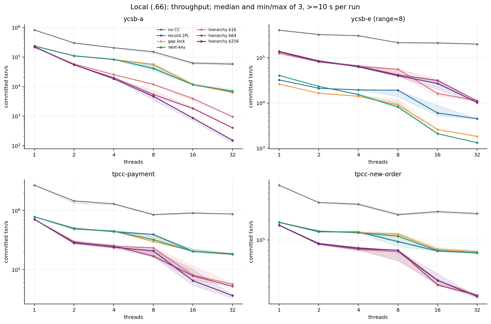
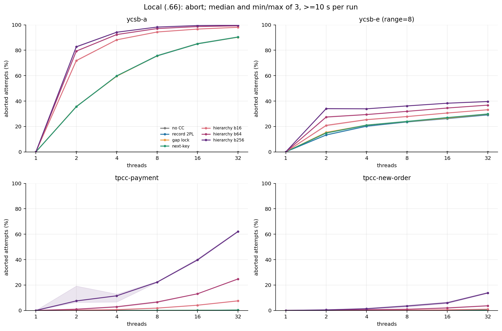
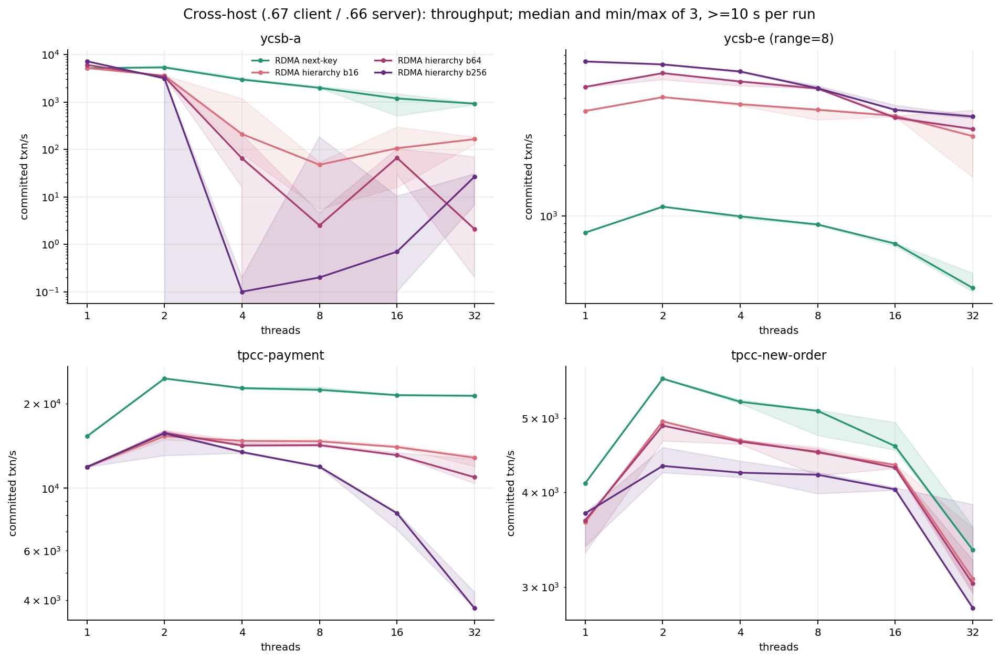
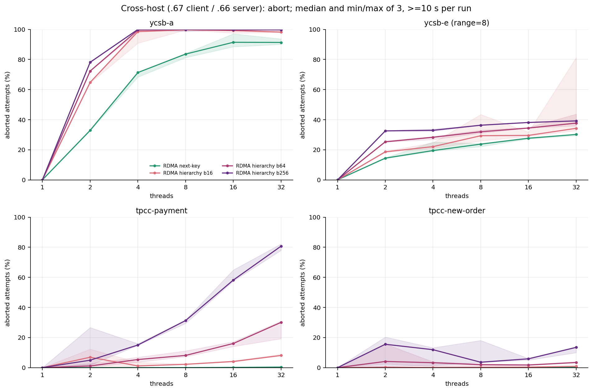
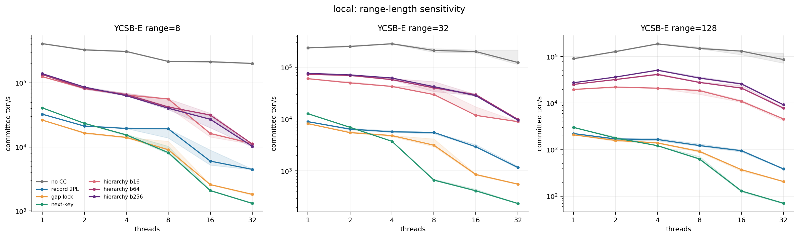
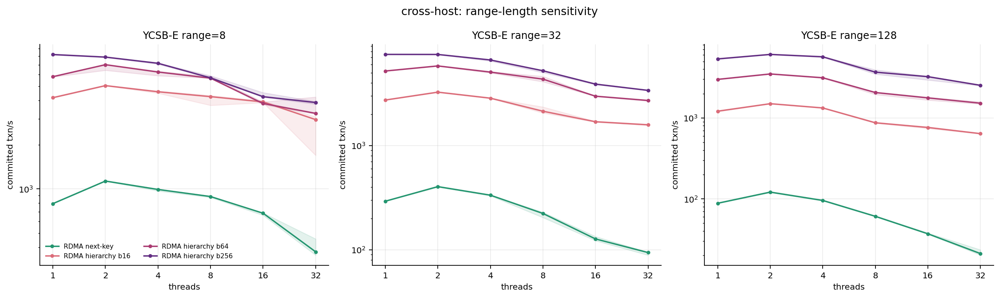
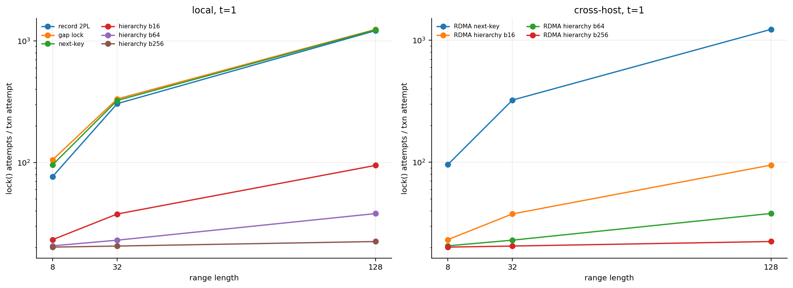
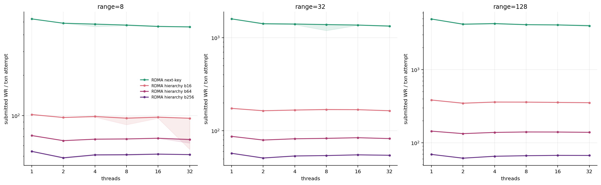
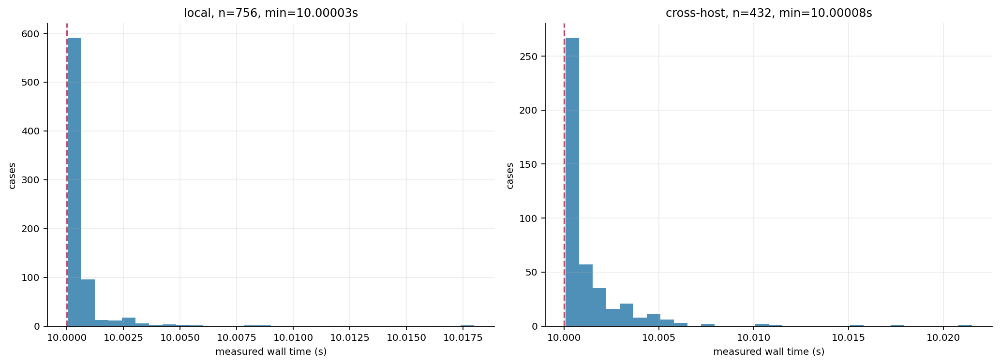
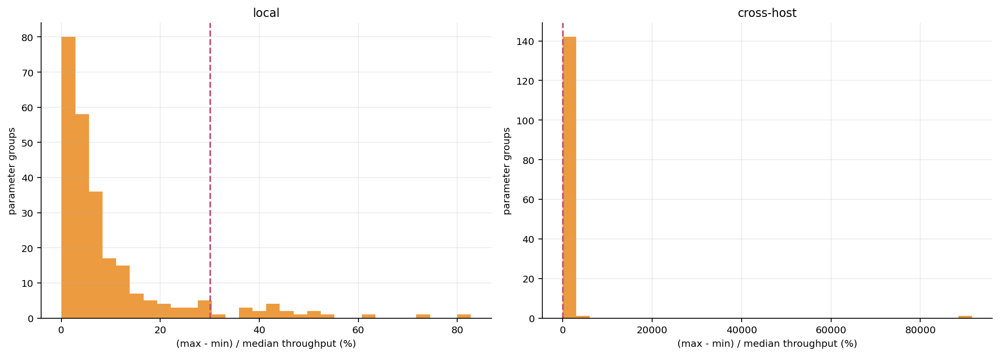

# 新代码正式矩阵报告（2026-11-02）

测量源码提交：8511d5bd517ef42f356f388459ee33f81f4d802c；C++ 实现基线为 596c94f，此后测量提交只增加运行配置与验收脚本。

配置：experiments/configs/formal_both_10s_20261102.json；原始 manifest：verified-campaign-20261102-225419.json。

运行开始 2026-11-02T22:54:19.378497；结束 2026-11-03T02:19:17.010925（.66 主机本地时钟）。

两端同源码 Release；mlx5_0 / GID=3；.66=10.0.0.3 server，.67=10.0.0.4 client；本地矩阵在 .66。

每 case >=10 秒，三次，seed=8/9/10；10,000 keys，trace 5,000 transactions 循环，10 ops/txn，Zipf=0.99，TPC-C items=5。

profile=0；linear；local gate=1；gate retry=64；RDMA QP=min(threads,2)。范围 8/32/128，线程 1/2/4/8/16/32，bucket 16/64/256。

## 数据验收

| 矩阵 | case | 参数组 | elapsed 最短/最长（秒） | 硬错误 | 容量中止 | gate 中止 |
|---|---:|---:|---:|---:|---:|---:|
| local | 756 | 252 | 10.00003 / 10.01798 | 0 | 0 | 0 |
| cross-host | 432 | 144 | 10.00008 / 10.02150 | 0 | 0 | 0 |

全部预期参数组合、run/seed、唯一性、三次重复、CSV 列宽、事务守恒及 profile 关闭均通过检查。

硬件 CTest 24/24、跨主机定向 3/3、16 点十秒容量预检先于正式矩阵完成；实验顺序执行，不并行争用 .66。

## 图表与解释

本地：成功事务吞吐，曲线为每点三次的中位数，阴影为最小—最大；层级锁三个 bucket 均展示。

本地：中止率，曲线为每点三次的中位数，阴影为最小—最大；层级锁三个 bucket 均展示。

跨主机：成功事务吞吐，曲线为每点三次的中位数，阴影为最小—最大；层级锁三个 bucket 均展示。

跨主机：中止率，曲线为每点三次的中位数，阴影为最小—最大；层级锁三个 bucket 均展示。

YCSB-E 的 range=8/32/128 扩展性，避免只挑短范围结果。

YCSB-E 的 range=8/32/128 扩展性，避免只挑短范围结果。

锁请求次数/尝试事务，t=1；这是调用强度，不等于峰值同时持锁数。

RDMA WR/尝试事务；profile 关闭时没有同步提交与排队计时，不能把 WR 数当 RTT。

所有 case 的真实 elapsed 分布；10 秒结束后包含完成/中止当前事务与释放锁的时间。

重复点波动；seed 也随 run 改变，三次不是纯计时噪声重复，不能据此构造严谨置信区间。

## 主要测量发现

本地 YCSB-A 的 none 基线：t1=823,385、t32=57,797 txn/s（0.070×）；该路径中止为零，扩展性下降不能归因于事务锁中止，需单独定位索引/共享资源争用。

local / YCSB-A / record-2pl / t32：成功吞吐 6,422.5 txn/s，中止率 90.32%；热点 no-wait 结果要同时看提交与尝试吞吐，不能仅用 attempts 衡量收益。

local / YCSB-A / gap-lock / t32：成功吞吐 6,261.0 txn/s，中止率 90.33%；热点 no-wait 结果要同时看提交与尝试吞吐，不能仅用 attempts 衡量收益。

local / YCSB-A / next-key / t32：成功吞吐 7,012.7 txn/s，中止率 90.39%；热点 no-wait 结果要同时看提交与尝试吞吐，不能仅用 attempts 衡量收益。

local / YCSB-A / hierarchical b16 / t32：成功吞吐 951.5 txn/s，中止率 98.09%；热点 no-wait 结果要同时看提交与尝试吞吐，不能仅用 attempts 衡量收益。

cross-host / YCSB-A / rdma-next-key / t32：成功吞吐 922.0 txn/s，中止率 91.37%；热点 no-wait 结果要同时看提交与尝试吞吐，不能仅用 attempts 衡量收益。

cross-host / YCSB-A / rdma-hierarchical b16 / t32：成功吞吐 164.4 txn/s，中止率 98.22%；热点 no-wait 结果要同时看提交与尝试吞吐，不能仅用 attempts 衡量收益。

## 成功吞吐数表

所有单元格为中位数 [最小值, 最大值]，单位 committed txn/s。

### local / ycsb-a / range=0

| 协议 / bucket | t1 | t2 | t4 | t8 | t16 | t32 |
|---|---:|---:|---:|---:|---:|---:|
| none | 823,385.0 [823,155.0, 824,352.0] | 300,673.0 [286,412.0, 303,611.0] | 206,477.0 [200,774.0, 207,598.0] | 151,769.0 [131,413.0, 151,797.0] | 62,495.3 [57,558.3, 66,223.3] | 57,797.2 [53,625.2, 65,683.3] |
| record-2pl | 236,214.0 [236,100.0, 236,520.0] | 110,399.0 [107,166.0, 112,558.0] | 81,976.8 [81,426.0, 82,892.4] | 56,526.4 [34,551.1, 58,561.7] | 11,775.5 [11,520.5, 11,842.4] | 6,422.5 [6,334.9, 6,882.6] |
| gap-lock | 236,798.0 [236,676.0, 237,076.0] | 108,790.0 [107,959.0, 110,648.0] | 82,536.8 [80,906.7, 83,851.7] | 57,029.3 [56,413.0, 59,511.7] | 11,816.3 [11,121.0, 13,558.9] | 6,261.0 [6,196.2, 6,563.2] |
| next-key | 236,897.0 [235,107.0, 237,351.0] | 110,072.0 [109,412.0, 110,392.0] | 84,088.7 [83,188.4, 85,153.4] | 41,226.2 [38,780.0, 57,811.3] | 11,655.7 [11,186.5, 11,857.0] | 7,012.7 [6,658.3, 8,253.0] |
| hierarchical / 16 | 215,128.0 [207,581.0, 216,674.0] | 58,268.1 [57,550.3, 59,951.9] | 25,391.2 [25,130.6, 25,887.0] | 11,896.6 [11,775.2, 12,314.5] | 3,938.9 [3,223.5, 4,141.4] | 951.5 [950.1, 963.6] |
| hierarchical / 64 | 220,212.0 [219,798.0, 220,389.0] | 54,410.0 [53,845.2, 56,020.6] | 20,101.5 [19,792.5, 20,240.2] | 5,411.7 [4,346.2, 7,256.2] | 1,817.8 [1,800.3, 2,041.1] | 402.5 [384.0, 410.3] |
| hierarchical / 256 | 225,660.0 [224,922.0, 225,668.0] | 54,744.6 [54,316.0, 57,029.5] | 18,391.4 [18,332.0, 18,880.5] | 4,698.8 [3,473.3, 4,891.4] | 864.8 [706.7, 869.5] | 151.5 [123.0, 160.6] |

### local / ycsb-e / range=8

| 协议 / bucket | t1 | t2 | t4 | t8 | t16 | t32 |
|---|---:|---:|---:|---:|---:|---:|
| none | 409,174.0 [404,350.0, 413,253.0] | 326,960.0 [325,272.0, 339,645.0] | 309,282.0 [303,524.0, 310,499.0] | 215,803.0 [214,844.0, 217,126.0] | 213,530.0 [207,207.0, 220,307.0] | 201,022.0 [200,456.0, 202,996.0] |
| record-2pl | 32,402.8 [32,330.6, 32,413.4] | 21,158.1 [21,057.0, 21,644.1] | 19,411.8 [19,392.9, 19,989.4] | 19,156.0 [13,786.7, 19,180.6] | 6,004.1 [5,210.6, 8,945.8] | 4,465.5 [4,415.9, 4,521.2] |
| gap-lock | 26,194.6 [26,179.7, 26,233.8] | 16,517.1 [16,115.6, 16,900.9] | 14,086.4 [13,764.5, 14,092.1] | 9,049.3 [8,900.2, 12,254.9] | 2,582.9 [2,559.8, 2,599.6] | 1,819.5 [1,764.8, 1,827.0] |
| next-key | 40,665.9 [40,652.0, 40,721.2] | 23,351.8 [23,333.5, 23,654.4] | 15,402.8 [14,911.3, 15,755.9] | 8,146.8 [7,811.0, 10,253.5] | 2,082.4 [2,077.0, 2,124.6] | 1,315.9 [1,297.2, 1,324.7] |
| hierarchical / 16 | 124,859.0 [124,696.0, 125,210.0] | 81,880.0 [79,093.7, 84,078.2] | 64,614.2 [63,948.5, 68,283.4] | 56,030.8 [41,522.6, 56,459.8] | 16,216.6 [14,284.8, 16,685.1] | 11,246.8 [10,993.3, 11,686.3] |
| hierarchical / 64 | 134,753.0 [134,476.0, 135,393.0] | 81,916.5 [81,049.3, 84,120.6] | 65,684.7 [64,997.8, 69,189.6] | 42,037.9 [40,870.1, 56,378.1] | 31,505.4 [27,486.4, 33,606.2] | 11,094.7 [10,780.9, 11,104.3] |
| hierarchical / 256 | 138,971.0 [135,152.0, 139,437.0] | 85,973.0 [80,127.8, 87,369.4] | 63,045.1 [62,674.7, 68,013.4] | 40,142.2 [38,204.5, 42,914.1] | 26,985.8 [19,909.4, 30,874.7] | 10,233.8 [9,992.8, 10,326.4] |

### local / ycsb-e / range=32

| 协议 / bucket | t1 | t2 | t4 | t8 | t16 | t32 |
|---|---:|---:|---:|---:|---:|---:|
| none | 237,567.0 [237,255.0, 238,532.0] | 252,466.0 [251,134.0, 263,922.0] | 284,804.0 [280,567.0, 289,673.0] | 211,166.0 [195,493.0, 229,682.0] | 201,315.0 [189,834.0, 215,878.0] | 123,998.0 [113,741.0, 216,314.0] |
| record-2pl | 8,945.2 [8,917.6, 8,961.6] | 6,416.0 [6,246.1, 6,681.8] | 5,691.9 [5,559.0, 5,977.1] | 5,553.0 [5,259.1, 5,568.1] | 2,927.5 [2,901.4, 3,230.2] | 1,169.3 [1,125.6, 1,231.2] |
| gap-lock | 8,192.1 [8,170.6, 8,221.6] | 5,498.3 [5,464.4, 5,824.5] | 4,819.3 [4,625.5, 4,857.6] | 3,143.5 [2,945.5, 4,161.2] | 854.8 [827.8, 872.5] | 557.4 [549.3, 567.3] |
| next-key | 12,732.2 [12,646.5, 12,733.7] | 6,967.1 [6,886.0, 7,019.0] | 3,739.1 [3,721.4, 3,753.8] | 667.3 [656.6, 695.7] | 414.7 [409.8, 444.6] | 236.0 [233.1, 238.1] |
| hierarchical / 16 | 60,386.3 [60,196.5, 60,387.4] | 50,003.0 [49,988.0, 53,052.5] | 42,792.7 [42,712.3, 43,534.5] | 29,812.5 [29,651.3, 42,233.7] | 11,833.6 [11,812.9, 17,258.8] | 8,946.6 [8,864.1, 9,019.9] |
| hierarchical / 64 | 73,202.9 [72,980.2, 73,504.9] | 69,823.3 [68,443.4, 70,744.4] | 57,881.5 [57,356.2, 60,827.3] | 40,156.9 [34,133.0, 53,158.3] | 29,640.5 [28,233.4, 30,021.9] | 9,919.7 [9,861.2, 10,025.0] |
| hierarchical / 256 | 76,549.5 [76,320.6, 76,791.1] | 71,394.7 [71,299.7, 71,683.9] | 62,157.1 [61,041.9, 62,893.7] | 42,352.4 [39,710.9, 43,215.7] | 28,401.9 [27,677.7, 30,647.3] | 9,607.7 [9,384.4, 9,654.1] |

### local / ycsb-e / range=128

| 协议 / bucket | t1 | t2 | t4 | t8 | t16 | t32 |
|---|---:|---:|---:|---:|---:|---:|
| none | 90,516.0 [88,429.4, 90,857.6] | 128,541.0 [126,418.0, 131,246.0] | 187,970.0 [186,853.0, 193,127.0] | 150,015.0 [148,446.0, 161,472.0] | 131,442.0 [110,009.0, 132,040.0] | 86,616.5 [72,577.6, 117,951.0] |
| record-2pl | 2,211.7 [2,202.9, 2,212.8] | 1,694.0 [1,621.0, 1,753.6] | 1,649.0 [1,552.3, 1,750.2] | 1,221.4 [1,183.4, 1,327.2] | 946.1 [891.6, 986.7] | 383.5 [378.4, 394.0] |
| gap-lock | 2,079.5 [2,077.9, 2,082.3] | 1,574.2 [1,506.4, 1,641.2] | 1,390.0 [1,368.9, 1,441.3] | 915.8 [876.9, 953.4] | 369.6 [345.4, 371.4] | 205.3 [204.4, 206.1] |
| next-key | 3,002.7 [3,002.6, 3,011.3] | 1,777.0 [1,762.7, 1,890.3] | 1,213.1 [1,210.8, 1,224.6] | 628.4 [609.9, 713.2] | 128.4 [122.6, 130.4] | 70.0 [68.3, 71.4] |
| hierarchical / 16 | 19,700.1 [19,518.6, 19,889.5] | 22,177.9 [21,560.0, 22,436.1] | 20,953.9 [20,882.7, 21,411.8] | 18,599.7 [15,485.9, 19,483.5] | 10,947.0 [10,443.4, 11,595.5] | 4,574.3 [4,173.5, 4,678.1] |
| hierarchical / 64 | 25,272.7 [25,257.9, 25,321.6] | 32,199.5 [31,972.3, 32,726.4] | 41,425.1 [40,329.0, 43,298.0] | 27,874.3 [27,592.8, 28,998.4] | 21,047.6 [20,887.5, 24,019.6] | 7,815.7 [7,460.5, 8,120.6] |
| hierarchical / 256 | 27,458.9 [27,424.6, 27,467.9] | 36,404.5 [36,059.8, 36,631.2] | 51,000.6 [50,995.0, 53,004.0] | 34,603.1 [33,796.5, 36,982.3] | 25,878.2 [25,152.5, 27,044.5] | 9,216.5 [9,029.2, 9,389.5] |

### local / tpcc-payment / range=0

| 协议 / bucket | t1 | t2 | t4 | t8 | t16 | t32 |
|---|---:|---:|---:|---:|---:|---:|
| none | 2,672,690.0 [2,668,130.0, 2,679,840.0] | 1,450,190.0 [1,307,840.0, 1,479,570.0] | 1,295,130.0 [1,247,700.0, 1,313,740.0] | 848,920.0 [835,269.0, 875,862.0] | 908,802.0 [876,981.0, 926,232.0] | 871,836.0 [863,442.0, 874,851.0] |
| record-2pl | 783,682.0 [782,932.0, 784,214.0] | 501,867.0 [490,010.0, 502,232.0] | 438,837.0 [429,635.0, 462,383.0] | 393,752.0 [380,726.0, 396,945.0] | 204,126.0 [194,812.0, 223,791.0] | 181,288.0 [179,926.0, 185,425.0] |
| gap-lock | 783,383.0 [781,790.0, 783,859.0] | 491,136.0 [476,276.0, 504,466.0] | 448,524.0 [443,983.0, 450,826.0] | 297,081.0 [293,159.0, 390,061.0] | 206,493.0 [205,244.0, 207,451.0] | 185,147.0 [175,404.0, 193,213.0] |
| next-key | 782,584.0 [779,063.0, 784,684.0] | 488,031.0 [482,992.0, 499,140.0] | 446,604.0 [437,362.0, 450,856.0] | 321,354.0 [311,283.0, 366,771.0] | 203,389.0 [199,962.0, 224,591.0] | 184,034.0 [179,479.0, 191,092.0] |
| hierarchical / 16 | 703,189.0 [702,745.0, 704,645.0] | 295,367.0 [287,235.0, 299,286.0] | 246,343.0 [241,184.0, 257,619.0] | 232,756.0 [168,602.0, 238,242.0] | 80,833.3 [75,966.6, 117,023.0] | 56,449.2 [54,338.8, 58,846.1] |
| hierarchical / 64 | 706,586.0 [706,488.0, 707,060.0] | 290,159.0 [289,952.0, 312,624.0] | 253,154.0 [246,615.0, 258,609.0] | 168,358.0 [167,139.0, 240,526.0] | 78,502.5 [66,613.7, 81,223.5] | 52,017.3 [51,324.9, 52,569.5] |
| hierarchical / 256 | 709,262.0 [708,917.0, 709,570.0] | 280,755.0 [271,691.0, 305,396.0] | 237,773.0 [228,557.0, 241,109.0] | 207,159.0 [162,409.0, 214,794.0] | 64,876.4 [53,847.5, 101,412.0] | 36,314.1 [32,783.3, 37,583.5] |

### local / tpcc-new-order / range=0

| 协议 / bucket | t1 | t2 | t4 | t8 | t16 | t32 |
|---|---:|---:|---:|---:|---:|---:|
| none | 649,406.0 [645,710.0, 650,083.0] | 360,019.0 [354,448.0, 362,748.0] | 338,337.0 [331,142.0, 354,245.0] | 237,022.0 [234,392.0, 249,744.0] | 264,079.0 [251,226.0, 264,725.0] | 247,039.0 [236,302.0, 249,384.0] |
| record-2pl | 182,287.0 [182,112.0, 182,879.0] | 132,539.0 [131,097.0, 134,637.0] | 131,920.0 [131,329.0, 137,744.0] | 94,499.8 [93,481.4, 97,964.0] | 68,625.2 [67,301.2, 75,586.4] | 64,672.1 [63,124.5, 67,966.4] |
| gap-lock | 183,225.0 [183,124.0, 183,357.0] | 136,261.0 [132,734.0, 136,302.0] | 128,917.0 [126,997.0, 133,546.0] | 122,023.0 [107,154.0, 127,288.0] | 72,924.8 [72,719.3, 78,951.6] | 66,857.0 [61,853.7, 69,434.4] |
| next-key | 183,155.0 [182,644.0, 183,633.0] | 135,277.0 [131,744.0, 136,295.0] | 128,098.0 [126,991.0, 129,927.0] | 114,310.0 [79,358.4, 127,848.0] | 69,609.3 [68,563.4, 72,484.2] | 64,719.8 [63,029.9, 70,884.9] |
| hierarchical / 16 | 165,324.0 [161,858.0, 165,577.0] | 87,166.3 [84,897.3, 87,715.9] | 72,842.5 [70,871.2, 79,580.1] | 66,698.8 [49,216.2, 66,764.4] | 24,990.0 [21,855.9, 26,126.9] | 15,192.0 [15,154.0, 15,593.1] |
| hierarchical / 64 | 165,905.0 [165,442.0, 166,137.0] | 87,144.0 [85,722.8, 88,428.3] | 73,839.6 [69,012.1, 74,070.2] | 70,498.8 [69,758.7, 71,547.5] | 21,507.0 [21,290.3, 22,999.3] | 15,160.5 [14,993.7, 15,500.8] |
| hierarchical / 256 | 166,044.0 [165,700.0, 166,430.0] | 89,002.4 [85,267.7, 89,716.1] | 76,028.9 [71,170.8, 78,658.4] | 70,278.1 [49,611.6, 70,835.2] | 25,267.1 [21,931.2, 31,677.6] | 14,486.0 [13,718.7, 14,573.7] |

### cross-host / ycsb-a / range=0

| 协议 / bucket | t1 | t2 | t4 | t8 | t16 | t32 |
|---|---:|---:|---:|---:|---:|---:|
| rdma-next-key | 5,161.1 [5,125.3, 5,162.2] | 5,350.5 [5,308.1, 5,810.1] | 2,967.7 [2,924.7, 3,234.6] | 1,983.4 [1,962.3, 2,126.5] | 1,186.1 [513.7, 1,493.0] | 922.0 [881.9, 966.0] |
| rdma-hierarchical / 16 | 5,195.0 [5,188.6, 5,211.6] | 3,587.2 [3,585.3, 3,622.3] | 210.5 [79.7, 1,181.3] | 47.5 [5.5, 54.1] | 105.8 [15.9, 297.9] | 164.4 [130.2, 182.7] |
| rdma-hierarchical / 64 | 6,040.3 [6,032.9, 6,046.0] | 3,396.8 [3,389.9, 3,417.7] | 64.9 [16.0, 208.2] | 2.5 [0.0, 4.6] | 66.6 [29.9, 102.9] | 2.1 [0.2, 69.8] |
| rdma-hierarchical / 256 | 7,207.0 [7,169.7, 7,239.4] | 3,140.2 [3,139.4, 3,169.2] | 0.1 [0.0, 0.2] | 0.2 [0.0, 183.0] | 0.7 [0.1, 10.4] | 26.5 [6.6, 30.5] |

### cross-host / ycsb-e / range=8

| 协议 / bucket | t1 | t2 | t4 | t8 | t16 | t32 |
|---|---:|---:|---:|---:|---:|---:|
| rdma-next-key | 793.9 [793.3, 797.1] | 1,131.3 [1,130.5, 1,132.5] | 991.5 [968.9, 999.8] | 887.3 [874.9, 892.4] | 683.2 [662.1, 687.2] | 373.2 [354.2, 456.9] |
| rdma-hierarchical / 16 | 4,179.3 [4,169.0, 4,185.0] | 5,048.9 [5,038.1, 5,068.3] | 4,584.3 [4,486.0, 4,645.9] | 4,246.8 [3,706.6, 4,331.7] | 3,911.5 [3,869.6, 3,972.3] | 2,963.7 [1,692.4, 3,095.0] |
| rdma-hierarchical / 64 | 5,806.9 [5,788.4, 5,843.4] | 7,009.6 [6,420.4, 7,012.6] | 6,248.2 [5,897.5, 6,330.8] | 5,674.9 [5,666.0, 5,851.3] | 3,814.1 [3,747.9, 3,909.0] | 3,268.0 [3,224.3, 4,225.2] |
| rdma-hierarchical / 256 | 8,217.9 [8,168.3, 8,248.2] | 7,892.8 [7,876.2, 7,895.1] | 7,166.7 [7,064.9, 7,192.5] | 5,701.2 [5,680.2, 5,901.0] | 4,245.2 [4,209.9, 4,527.7] | 3,873.8 [3,779.5, 3,940.0] |

### cross-host / ycsb-e / range=32

| 协议 / bucket | t1 | t2 | t4 | t8 | t16 | t32 |
|---|---:|---:|---:|---:|---:|---:|
| rdma-next-key | 292.3 [292.1, 292.4] | 403.5 [399.3, 403.8] | 334.0 [329.4, 335.5] | 223.0 [203.9, 229.6] | 127.1 [122.3, 134.1] | 94.0 [88.8, 94.8] |
| rdma-hierarchical / 16 | 2,731.8 [2,730.3, 2,745.9] | 3,251.6 [3,239.2, 3,252.4] | 2,846.4 [2,833.8, 2,860.8] | 2,133.5 [2,052.4, 2,347.0] | 1,691.2 [1,677.8, 1,706.0] | 1,581.1 [1,559.1, 1,585.6] |
| rdma-hierarchical / 64 | 5,186.7 [5,181.4, 5,198.8] | 5,802.4 [5,781.1, 5,826.0] | 5,062.9 [4,971.2, 5,131.0] | 4,336.1 [4,095.3, 4,616.5] | 2,973.6 [2,959.4, 2,974.5] | 2,705.6 [2,668.4, 2,719.1] |
| rdma-hierarchical / 256 | 7,486.7 [7,469.2, 7,502.9] | 7,475.9 [7,463.6, 7,487.0] | 6,620.1 [6,460.5, 6,642.6] | 5,217.7 [5,013.6, 5,226.6] | 3,882.2 [3,851.7, 3,929.5] | 3,380.7 [3,374.8, 3,381.3] |

### cross-host / ycsb-e / range=128

| 协议 / bucket | t1 | t2 | t4 | t8 | t16 | t32 |
|---|---:|---:|---:|---:|---:|---:|
| rdma-next-key | 88.2 [87.8, 88.3] | 121.1 [119.8, 122.9] | 95.5 [94.6, 97.1] | 60.8 [60.4, 61.7] | 37.0 [36.8, 37.9] | 21.1 [20.2, 23.5] |
| rdma-hierarchical / 16 | 1,211.1 [1,194.4, 1,218.3] | 1,499.0 [1,498.5, 1,501.6] | 1,327.7 [1,326.0, 1,331.1] | 871.0 [858.6, 871.5] | 762.0 [741.5, 778.1] | 639.3 [634.7, 640.7] |
| rdma-hierarchical / 64 | 2,993.8 [2,982.1, 2,996.1] | 3,493.4 [3,477.8, 3,499.7] | 3,134.6 [3,110.2, 3,155.0] | 2,059.9 [1,945.7, 2,086.4] | 1,768.5 [1,660.6, 1,805.4] | 1,519.7 [1,484.3, 1,581.1] |
| rdma-hierarchical / 256 | 5,360.1 [5,331.0, 5,365.6] | 6,090.2 [6,074.5, 6,112.1] | 5,690.2 [5,634.1, 5,701.4] | 3,676.9 [3,477.4, 3,933.2] | 3,233.9 [2,941.6, 3,274.1] | 2,528.0 [2,497.4, 2,546.0] |

### cross-host / tpcc-payment / range=0

| 协议 / bucket | t1 | t2 | t4 | t8 | t16 | t32 |
|---|---:|---:|---:|---:|---:|---:|
| rdma-next-key | 15,299.0 [15,284.2, 15,302.6] | 24,577.3 [24,567.6, 24,717.3] | 22,712.5 [22,572.3, 22,849.7] | 22,401.8 [22,280.5, 22,897.5] | 21,449.9 [21,293.5, 21,510.8] | 21,330.7 [21,192.3, 21,364.5] |
| rdma-hierarchical / 16 | 11,891.4 [11,890.6, 11,902.6] | 15,325.1 [14,885.2, 16,117.1] | 14,738.8 [14,435.4, 14,811.4] | 14,683.0 [14,647.8, 14,940.2] | 14,013.7 [13,989.2, 14,236.7] | 12,838.6 [11,967.7, 13,044.4] |
| rdma-hierarchical / 64 | 11,871.0 [11,839.9, 11,893.6] | 15,740.1 [15,632.9, 16,006.8] | 14,193.2 [14,116.7, 14,483.3] | 14,235.1 [14,100.8, 14,421.7] | 13,113.0 [13,091.9, 13,398.6] | 10,943.2 [10,410.3, 12,704.4] |
| rdma-hierarchical / 256 | 11,915.4 [11,909.9, 11,927.7] | 15,677.9 [13,081.3, 16,005.5] | 13,449.7 [13,346.5, 13,512.3] | 11,919.3 [11,891.8, 12,042.2] | 8,145.4 [7,120.4, 8,224.1] | 3,741.2 [3,735.4, 4,270.4] |

### cross-host / tpcc-new-order / range=0

| 协议 / bucket | t1 | t2 | t4 | t8 | t16 | t32 |
|---|---:|---:|---:|---:|---:|---:|
| rdma-next-key | 4,107.9 [4,106.0, 4,111.8] | 5,637.0 [5,634.1, 5,652.4] | 5,256.3 [5,229.3, 5,289.6] | 5,113.6 [4,749.5, 5,128.8] | 4,595.7 [4,543.5, 4,937.4] | 3,356.3 [3,353.0, 3,604.4] |
| rdma-hierarchical / 16 | 3,653.5 [3,649.3, 3,658.3] | 4,954.4 [4,949.5, 4,960.1] | 4,675.7 [4,675.2, 4,681.1] | 4,506.8 [4,499.5, 4,582.1] | 4,341.5 [4,336.1, 4,351.6] | 3,078.2 [2,956.3, 3,588.8] |
| rdma-hierarchical / 64 | 3,671.2 [3,327.0, 3,675.2] | 4,890.0 [4,670.2, 4,935.7] | 4,658.8 [4,624.1, 4,682.9] | 4,516.8 [4,204.9, 4,557.5] | 4,305.3 [4,297.1, 4,306.6] | 3,030.7 [2,939.0, 3,253.8] |
| rdma-hierarchical / 256 | 3,749.4 [3,393.7, 3,760.2] | 4,328.7 [4,242.9, 4,580.0] | 4,240.8 [4,182.6, 4,394.1] | 4,214.2 [3,981.1, 4,246.3] | 4,031.3 [4,023.7, 4,054.7] | 2,816.4 [2,812.1, 3,852.5] |

## 中止构成与测量边界

| 矩阵 / 协议 | 尝试事务 | 中止 | conflict | capacity | gate | 其余中止 |
|---|---:|---:|---:|---:|---:|---:|
| local / none | 464,592,320 | 0 | 0 | 0 | 0 | 0 |
| local / record-2pl | 129,630,204 | 14,946,203 | 14,945,074 | 0 | 0 | 1,129 |
| local / gap-lock | 128,007,749 | 15,425,261 | 15,424,131 | 0 | 0 | 1,130 |
| local / next-key | 127,132,468 | 14,554,231 | 14,553,098 | 0 | 0 | 1,133 |
| local / hierarchical | 386,400,795 | 109,147,833 | 109,144,445 | 0 | 0 | 3,388 |
| cross-host / rdma-next-key | 6,798,150 | 1,384,075 | 1,382,946 | 0 | 0 | 1,129 |
| cross-host / rdma-hierarchical | 26,686,914 | 10,269,474 | 10,266,084 | 0 | 0 | 3,390 |

其余中止包括窗口结束、扫描后验证等没有独立列的路径，不能全部解释成逻辑锁冲突。总数只作核账；不同点尝试次数差异很大，性能比较使用逐点比率。

## 发现的问题与建议顺序

1. 37/396 个参数组的 (max−min)/median >30%；应先复测这些点，不能只取最好一次。

2. 优先定位本地无事务锁的索引扩展性：分别测 update、insert/delete，加入根/结构写路径与 latch 等待的定向采样；本矩阵没有这些计时，不能断定某一把 latch 是唯一原因。

3. 再分析热点下 no-wait 的中止与浪费：固定 Zipf、bucket、线程做单变量对照，保留原隔离和提交后释放时机，不通过增添 sleep 掩盖冲突。

4. 前一轮固定 5,000 事务检查误用了脚本原默认 duration=0；这批 756+432 行未用于本报告正式图表。脚本默认已改为 10，正式结果逐行检查 >=10 秒。

5. 当前 next-key 仍逐区间调用 lock；本轮没有实现跨逻辑区间的批处理。WR/事务高只能说明操作量，profiling=0 时无法从这些数据定量区分软件排队、gate 等待与 NIC 往返。

6. 现有曲线同时改变协议和锁覆盖粒度，hierarchical 的较少调用与更粗冲突域需要一起解释；bucket 16/64/256 全部保留，没有每点挑选最佳 bucket。

7. 本地工作负载在 .66、跨主机工作负载在 .67；本地/远端吞吐比包含客户端平台和传输路径，不能称为纯网络延迟或 RDMA 加速比。

8. none 是无事务隔离的数据路径参照，record-2pl 不防幻读；协议性能排序不能代替隔离正确性结论。

9. 三个 run 用 seed 8/9/10；按 run 配对可比较同 trace，但三次的最小—最大不等同固定 trace 的纯运行波动，也不是置信区间。

10. TPC-C 仅覆盖本项目的 Payment/New-Order 子负载与键映射，不是完整标准 TPC-C 吞吐认证，不能标为 tpmC。

11. 这些矩阵不替代一小时结构/事务正确性压力；十秒收尾发生的事务中止仍进入计数，不应把 aborted 全部简单归为 conflict。

## 复现和数据定位

本地 CSV：/home/dell/RdmaRangeLock/experiments/results/formal-local-20261102-225727.csv

跨主机 CSV：/home/dell/RdmaRangeLock/experiments/results/formal-cross-host-20261103-010404.csv

本地 SHA-256：4d41b9c8a9ffb471ce26c39dd99c424c9e714804ce9f406b7c6b4bef7eb210bd

跨主机 SHA-256：908e9aa8f76afc2284958a0da3f933f27fbd4f5d06b6316724758ee7400f8ed6

完整日志：/home/dell/RdmaRangeLock/experiments/logs/verified-20261102-225419

远端快照：/tmp/rrl-formal10-J2AFq2/RdmaRangeLock

运行：python3 scripts/run_verified_matrices.py

报告：python3 scripts/build_verified_report.py --campaign experiments/results/verified-campaign-20261102-225419.json

原始 CSV/JSON、日志、源码归档与构建产物不入 Git；图表、分析脚本与报告入库。
