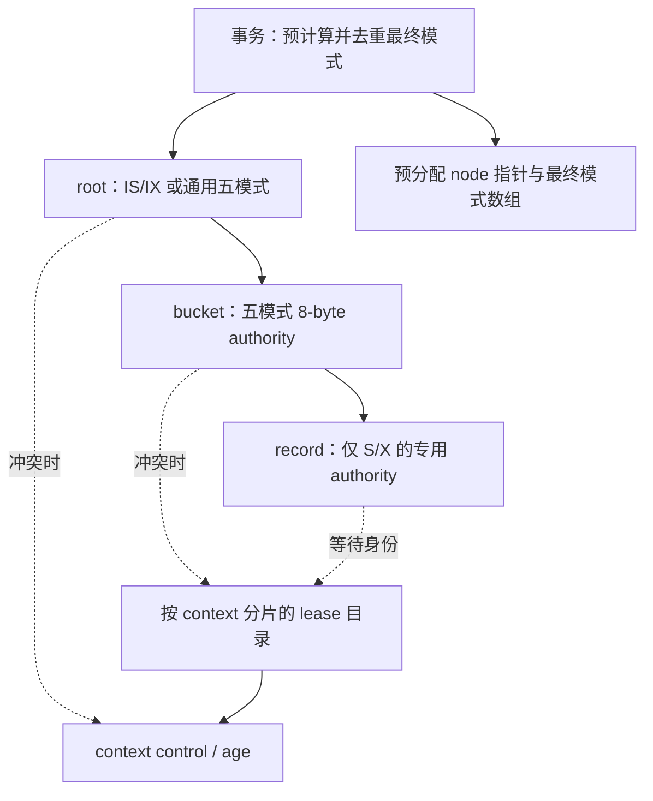

# 五模式层级锁的本地 CAS 设计

状态：设计，尚未接入 executor 或完成性能验证。

目标机器 `10.102.35.66`，worktree `/home/dell/RdmaRangeLock-record2pl-20261112`，分支 `codex/record2pl-compact-20261112`。第一阶段针对已有固定桶 `root → bucket → record`，不改算法保护范围，不混入 B+ 树 separator/leaf 命名与结构维护。支持 `IS、IX、S、SIX、X` 五模式，64 个 active contexts。

## 1. 兼容矩阵与资源身份

| 请求/已持有 | IS | IX | S | SIX | X |
|---|---|---|---|---|---|
| IS | ✓ | ✓ | ✓ | ✓ | × |
| IX | ✓ | ✓ | × | × | × |
| S | ✓ | × | ✓ | × | × |
| SIX | ✓ | × | × | × | × |
| X | × | × | × | × | × |

同一事务重复请求先做能力合并；不能按 enum 大小取 max。例如 `S + IX = SIX`、`S + IS = S`、`IX + IS = IX`、`SIX + X = X`。兼容判断排除该事务已经持有的贡献。

固定桶命名沿用 `src/txn/hierarchical_plan.h`：`bucket = key / width`，不是 B+ 树物理节点。bucket 状态与 record 状态属于不同资源空间，即使 width=1、区间数值相同，也不能共享一个状态字。

范围扫描锁住所有相交 bucket 的 S，包括没有返回记录的 bucket；同桶有写则合并为 SIX，并为实际写入 key 保留 record X。纯点写为 bucket IX + record X，不能把整个 bucket 升成 X。bucket S/SIX 已覆盖的 record S 不再请求。

## 2. 节点状态：一个 64 位原子字

```text
63                         29 28 27          21 20          14 13           7 6            0
+----------------------------+--+--------------+--------------+--------------+--------------+
|      change_sequence:35    | T|  owner:7     |  S_count:7   | IX_count:7   | IS_count:7   |
+----------------------------+--+--------------+--------------+--------------+--------------+
```

- IS/IX/S 是**不同事务数**，每项 7 位，范围 0–127；64 contexts 足够，同事务重复获取不重复计数。
- `owner=0` 无 SIX/X；`owner=slot+1` 表示 context 0–63 的 SIX/X owner。owner 非零时，T=0 为 SIX，T=1 为 X；owner 为零时 T 必须为零。
- SIX/X 不计入三个共享计数，避免一份持锁被重复计算。SIX 存在时允许其他事务的 IS；X 存在时三个计数必须全部为零。
- `change_sequence` 在每次成功获取、模式转换、释放时递增，用于冲突慢路径验证 holder 快照，不能仅比较可能发生 ABA 的三个计数。
- 64 个 context 可以同时持有 IS、IX 或 S，没有第 64 个 S 转 X 的限制；slot 只用于单 owner 字段，不占读者 bitmap。
- 节点对齐到 8 字节并检查 `atomic<uint64_t>::is_always_lock_free`。这是 8 字节 grant authority，不等于等待策略所需的所有元数据只有 8 字节。

sequence 不允许静默回绕。在接近上限时停止该节点的新获取/转换，预留至少 64 次释放的序列空间；报告耗尽并排空本轮，不在运行中复用序列。若未来要循环重置，必须增加明确的全局静默点协议。35 位约 343 亿次状态变化，持续热点运行仍需处理该边界。

## 3. 一次 CAS 完成兼容检查后的获取

先用本事务已经持有的模式构造 `others`，**只在寄存器中扣除自己**，共享内存中的旧锁始终保留；随后判断新合并模式与 others 的兼容性。

| 请求模式 | 对 others 的允许条件 | 写入新状态 |
|---|---|---|
| IS | 没有 X owner | IS_count + 1 |
| IX | 没有 owner 且 S_count=0 | IX_count + 1 |
| S | 没有 owner 且 IX_count=0 | S_count + 1 |
| SIX | 没有 owner 且 IX_count=0、S_count=0 | owner=slot+1，T=0 |
| X | 没有 owner 且 IS/IX/S 三个计数全为 0 | owner=slot+1，T=1 |

```cpp
old = node.load(std::memory_order_acquire);
for (;;) {
    others = remove_own_contribution(old, held_mode); // local arithmetic
    if (!compatible(others, target_mode)) return conflict_slow_path(old);
    desired = add_contribution(others, target_mode, slot);
    desired = advance_sequence(desired);
    if (node.compare_exchange_weak(old, desired,
            std::memory_order_acq_rel, std::memory_order_acquire)) {
        local_held_mode = target_mode;
        return Ok;
    }
    if (retry_budget_expired()) return Deadline;
}
```

无竞争时是一次成功 CAS；有竞争时可能重试，不能承诺每次加锁仅执行一个 CAS，也不能承诺整个事务/层级路径只需一次 CAS。重复获取且已有模式覆盖请求时直接返回，不修改共享字。

模式升级，例如 `S → SIX`、`IX → SIX`、`SIX → X`，只用一个 CAS 将旧贡献替换为新贡献；失败时原锁保持不变。禁止先释放旧模式再重新申请。多个 S 同时升级 X 仍可能产生转换死锁，交给既有 no-wait / wait-die / wound-wait 解决；事务预规划能避免的升级直接消除。

## 4. 释放与本地事务记录

预分配持锁项 `{node*, final_mode}`，按预规划的稳定顺序填写；事务内用计划项索引定位，避免运行时 hash/map 和线性查找。计划已去重，一资源一项，记录最终模式而不是获取次数。

- 普通 IS/IX/S 释放，可在计数和序列不会溢出的约束下，用一次 `fetch_add(sequence_step - mode_delta, release)` 同时减计数并推进 sequence；必须验证数学上不会借位越过计数字段。
- SIX/X 的 owner 清除用 CAS；不能 `store(0)`，因为 SIX 可能与其他事务的 IS 共存，且 sequence 必须保留。
- 先完成数据写回，释放后代 record，再释放 bucket 和 root。中途获取失败，按已成功获取的本地项清理；不扫描整个表。
- commit/wound 状态沿用每 context 的独立原子 control；伤害不能直接清空对方锁，由被伤害事务在停止数据访问后释放。进入 Committing 后不再允许被伤害。

## 5. 三种等待策略：authority 与 holder 身份分开

### no-wait

计数/owner 足够决定兼容性。冲突立即返回；不分配共享 holder 目录、不维护 holder bitmap、不获取全局事务 age。只更新本 context 的本地持锁数组和必要状态。

### wait-die / wound-wait

计数无法告诉我们是谁持有 IS/IX/S，也无法正确选择等待/伤害对象。保留 8 字节 CAS authority，额外预分配**按 context 分片的原子 lease 字节数组**：`leases[context][node_id]`。一个字节编码五模式及 acquiring/held/releasing 阶段；事务 generation/age 存在已有 context control 中。

每个 context 的行起点及长度按 cache line 对齐，减少不同 worker 的发布写入相互争用；冲突时跨 context 读取，额外访问发生在慢路径。所有 node/context 坐标在运行前确定，不用动态 holder 对象、链表、map 或 mutex。

发布协议必须先于 authority 的变化，不能在成功 CAS 后才留下可见踪迹：

```text
获取：lease = acquiring(target) → authority CAS → lease = held(target)
失败：lease 恢复原 held 模式或 empty
转换：lease = converting(old,target) → authority CAS → lease = held(target)
释放：lease = releasing(old) → authority RMW → lease = empty
```

acquiring/converting/releasing 阶段不等待其他锁；authority 冲突后先恢复稳定 lease，再进入等待算法。转换前的旧模式保存在私有项中。阶段发布与读取使用 release/acquire，authority 使用上节原子顺序；不能使用普通字节制造 C++ data race。

冲突者收集：

1. acquire-load 节点完整 word 为 w1（含 sequence）。
2. 扫描最多 64 个对应 lease，排除自己；读取 context control/age/control 验证 generation 稳定。
3. 遇到相关过渡 lease 或 context 代际不稳定，重采样，并检查截止时间；不能把 pending 当作已经授予的持锁人。
4. acquire-load 节点为 w2。要求 w1==w2，并且收集到的稳定模式计数/owner 与 authority 相符，否则重采样。
5. 得到某一时刻的精确 blocker 集：wait-die 只在请求者比所有 blocker 年长时等待；wound-wait 仅尝试伤害较年轻的 blocker，且用完整 generation/control CAS，失败则重新观察。

快照成立后锁仍可能变化，因此等待循环每次重试 authority；对状态槽的伤害 CAS 必须再次确认目标 generation 和 Running，不能伤害复用槽的新事务。被请求者已经 Committing 时等待其完成。

这是设计中必须单独验证的并发协议。不能只更新计数，再无保护地遍历普通本地 vector；也不能从旧 owner slot 或旧 lease 直接伤害新事务。

额外空间为 `contexts × round_up(node_count,64)` 字节，另有每个 context 的本地持锁项。以 N=100,000、width=256 为例，root+bucket=392 个 node，authority 为 3,136 字节，64-context lease 约 28 KiB。record 是另一套资源：若也采用该计数方案，其等待目录需额外约 6.1 MiB，不能漏报。按 NUMA 首触本 context 行，authority 的 NUMA 放置单独测量。

wait-die/wound-wait 的逻辑事务仍需稳定全序 age；初版保留每新逻辑事务一次 age ticket，重试沿用。不要为了减少原子操作破坏年龄规则。lease 发布的两次共享 store 及冲突扫描属于实际成本，必须与 bitmap 方案测量后比较。

## 6. 三层各自专用化



record 不带无用的 IS/IX/SIX 分支。可采用同一 8 字节布局的 S/X 子集及上述 lease，以正确支持全部 64 个读者；不要继续继承第 64 个 S 转 X 的保守行为。是否复用现有 bitmap record authority 作为对照版本，应由同 trace 的 32/64-thread 实测决定。

width 是 2 的幂时 bucket ID 用移位，其他 width 使用预构造的固定除数换算；不改变 bucket 区间。dense node ID 直接定位，sparse key 才查静态目录。五模式兼容关系内联成 mask/字段测试，按协议和等待策略编译分支，避免虚接口和九模式通用表。

计划构造放在测量边界之外，沿用当前 benchmark 的预规划条件，不提前决定冲突或事务顺序。不要扩展成热 key 调度优化。加锁遵循 root、按 bucket ID 升序、按 record key 升序，释放逆序；计划覆盖整个事务时，后续操作不再重复获取祖先意向锁。

## 7. root 的性能与可选消除

全体事务在 root 上修改同一个 word，即使 IS/IX 完全兼容，仍会产生 cache line 争用。计数压缩不能消除这个瓶颈。

先提供完整五模式 root 的基准版本，再提供**显式的 intention-only-root 特化**：只有执行环境保证本轮根上永远不请求 S/SIX/X 时，根 IS/IX 对其他合法根请求永远兼容，可以用隐式祖先意向，不写共享 root word。配置一旦允许全表覆盖锁，必须回到真实 root authority，不能在运行中无协议切换。

实验分别标记 root=cas 和 root=implicit-intent。不能把后者报告为支持任意根级五模式的同一实现。若要在动态全表 S/X 到来时仍减少 root 热点，需要另设计分片意向与冻结/排空协议，初版不混入。

相邻 bucket 是否填充到 64 字节按实验选择：dense 8 字节节省空间但可能 false sharing；64 字节 padding 增加空间但降低跨桶写共享。不能只凭最小字节数认定最快。先测 dense/padded 两版本，默认以目标负载结果决定。

## 8. 粒度转换不能丢保护

初版 executor 接当前静态最终模式计划；五模式 authority 自身仍提供原子转换。后续再接 `RuntimeBuckets`：

- 升粒度：先成功获取/转换父 bucket 的 S/X/SIX，再释放被其覆盖的后代锁；失败时保留全部旧锁。
- 降粒度：先重新获取全部历史访问所需的细粒度保护，再减弱父模式；不能只锁当前返回的行。
- 尤其历史 range predicate 包含空洞。降为单纯 record S 会丢失幻读保护；在没有专用精确谓词或稳定区间单元方案前，不宣称支持去掉父 S 的任意扫描降粒度，不偷偷回到通用区间锁扫描。

## 9. 实现与验证顺序

1. 五模式 NodeWord 的 no-wait 获取、去重、转换和释放；64 contexts 全部 S/IS/IX 不产生额外兼容性限制。
2. 固定桶专用 executor，保留真实 root CAS，对照 generic，避免同时变更多种语义。
3. generation-safe lease 发布与快照，接 wait-die/wound-wait；先 correctness，再测额外发布开销。
4. root intention-only 特化、bucket dense/padded、record 计数/位图分开测；需要区分的选项写进结果元数据。
5. 最后接符合持续保护条件的粒度转换；separator/leaf/DAG 作为独立后续适配。

正确性覆盖五模式 25 对兼容关系、多 holder 组合、全部 64 contexts、重复获取、所有有效模式合并、并发升级/释放、部分计划失败清理、slot 复用、伤害与提交竞争、lease 发布中断、sequence 临界值、width=1、UINT64_MAX、空扫描和插入/删除。用强制交错测试验证 authority CAS 与 lease 发布之间的窗口，不只做随机压测。

性能测试仍用项目 YCSB-E，每事务 10 操作，generic/compact 相同 trace，三种等待策略、1/2/4/8/16/32/64 线程，width=16/64/256，uniform 和高偏斜分开；有 warmup 的时长实验与无 warmup 的一次性初始插入实验分开。逐项报告提交吞吐、重试/中止、等待、未完成、CAS 重试、root/bucket/record 开销、authority/lease/held 内存。统计关闭与开启作为独立配置，不能把测量开销差异当作锁实现收益。

结论：8 字节可以容纳五模式、64-context 精确兼容判定与单 owner；等待算法的多 holder 身份放在预分配辅助目录中。目标是无冲突热路径固定字段运算加一次成功 CAS，真正冲突才读取 holder 身份；不声称所有状态、所有等待逻辑和整个事务都能压进单个 8 字节 CAS。
