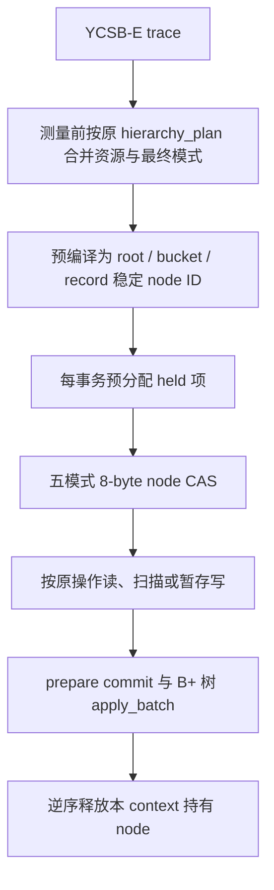

# 固定桶层级锁 CAS 实现

实现位于 `.66` 的 `/home/dell/RdmaRangeLock-record2pl-20261112`，分支 `codex/record2pl-compact-20261112`。当前实现仅涵盖本地固定桶 `root → bucket → record`；separator、leaf、DAG 和在线粒度转换仍走通用路径。

## 热路径

去掉专用执行器上的通用 range-manager mutex、事务范围匹配、运行时 map 搜索和动态 holder 对象。计划在计时前生成；运行时使用 node ID，不做区间查找。同事务同 node 的模式在计划阶段合并，bucket scan 使用 S，bucket scan + write 使用 SIX，普通 point write 使用 IX + 实际 record X；不同 record 的写不会互相排斥。桶锁保护空扫描范围，防止区间内新插入形成 phantom。

### 节点 CAS word

| 位 | 含义 |
|---|---|
| 0–6 | IS holder 数 |
| 7–13 | IX holder 数 |
| 14–20 | S holder 数 |
| 21–27 | SIX/X owner context，0 代表没有 exclusive owner |
| 28 | owner 类型，0=SIX，1=X |
| 29–63 | 状态变化序号 |

每个共享计数统计不同事务，不统计该事务对同一资源的重复申请。SIX/X 使用单 owner 字段。64 contexts 可同时分别持有 IS、IX、S，不再把第 64 个 S 错当作 X。五模式的 acquire 和升级由同一 8-byte CAS authority 线性化；无竞争获取一次成功 CAS，有竞争时会重试。释放使用原子 RMW/CAS 保留序号并移除该 context 的贡献。

no-wait 不分配 holder sidecar。wait-die/wound-wait 使用按 context 分片、cache-line 对齐的原子 lease bytes；它只在冲突慢路径读取身份。lease transitional 标记让竞争者等待 authority 与 holder 发布/释放完成后再快照。等待策略仍为每逻辑事务获取 age ticket；重试沿用 age。每 context 预分配 node/mode held 数组，失败会清理已获得的锁。提交后逆序释放；wound 不直接替别的事务释放其锁。

## 两个实验开关

- `--hierarchy-lock-table generic|compact` 选择后端；支持的本地固定桶自动选择 compact，显式 generic 用于对照。
- `--hierarchy-implicit-root 1` 消除 root word 更新，限于当前 root 计划只有 IS/IX 的固定计划。auto 默认按等待策略选择：no-wait/wait-die 省去 root CAS；wound-wait 保留 root word。出现任意 root S/SIX/X 的算法配置必须使用真实 root word。
- `--hierarchy-padded 1` 每个 node word 单独占 64 bytes，作为 false-sharing 控制。auto 对 no-wait/wait-die 开启 padding；wound-wait 保持 dense。目标机 YCSB-E width=256 的 32/64 thread 测试中 padding 对 no-wait/wait-die 提高约 3–6%，额外付出 8 倍 node word 空间；wound-wait 下 padding 降低吞吐，因此其默认保持关闭。
- `--hierarchy-latency 0 --hierarchy-statistics 0` 移除细粒度直方图、操作数、行数和 checksum 的统计开销；提交/中止/重试及安全错误计数仍保留。

空间 CSV 列为 `hierarchy_lock_bytes,state_bytes,held_capacity_bytes,lease_bytes,plan_bytes,cas_retries`。generic 的 compact 内存字段为 0 表示未测量。implicit-root 当前仍给 node ID 0 分配了 word，因此它减少 root 的写争用，但还没有省下该 8 bytes。lease 空间是 `contexts * ceil(node_count/64) * 64 bytes`，只有等待策略需要。padded 空间是 `node_count * 64 bytes`。

兼容规则和正确性基于五种模式。`U/IU/SIU/UIX` 及其它扩展模式不被 compact authority 接受。`hierarchy_escalation_threshold` / `hierarchy_deescalate_after`、leaf/separator/DAG、共享或远程状态配置不走 compact executor。当前固定 root/bucket/record 计划在开始前静态确定；任意动态粒度转换需另外证明父子锁转换过程不会暂时丢失保护。

测试包括 25 组 S/X/IS/IX/SIX 两两兼容、模式 join 和原子升级、全部 64 slots、共享释放保留、多线程冲突、安全发布窗口强制交错、slot generation 重用、sequence/budget 边界、三种等待策略、width=1/16/256 generic 等价、空扫描 phantom 插入。回归使用 YCSB-E。

## YCSB-E TPS

完整数据与曲线见同目录 `reports/hierarchy-ycsbe-20261113`：每事务 10 操作；generic / compact 逐 case 同 seed、同 key/trace 参数；1/8/32/64 threads、bucket width 16/64/256、三策略、三轮。每轮同一配置在不同后端交错顺序，warmup 1 秒、测量 2 秒，报告提交 txn/s 中位数、min/max、中止/提交、重试/提交、等待、未完成、重试耗尽、deadline abort、内存和 CAS 重试。结果不用于推断其他数据库或其它负载。

高偏斜 trace 重复读写范围较多；吞吐必须与未完成/重试一起看。duration 测试会循环同一条有限 trace，所以并非持续填充全新数据 key。表格同时保留原始 stdout/stderr、命令、源码快照和校验和。
