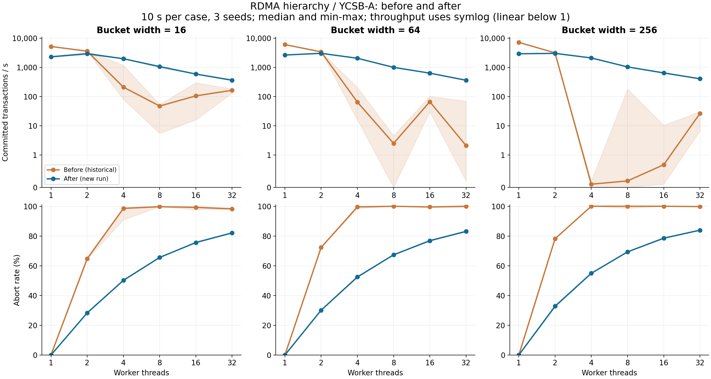
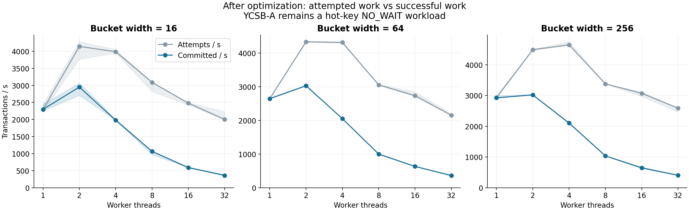

# RDMA 层级锁 YCSB-A 优化前后定向复测（2026-11-03）

只重跑跨机 RDMA 层级锁的 YCSB-A 子集；没有运行本地矩阵、其他协议或 YCSB-E。

优化前测量提交 `8511d5bd517ef42f356f388459ee33f81f4d802c`，来自已验收的历史十秒正式批次；优化后提交 `81bd252ee41161ee745591d81c1bd1132a2ecd97`，实现修复来自 `cf3612b`。本次未重新运行旧代码，是历史基线与新测量的比较，无法完全排除两个时段的系统噪声，也不能把组合补丁的收益拆分归因。

## 配置与验收

配置：`experiments/configs/rdma_hierarchy_ycsba_20261103.json`。每 case 10 秒；seed=8/9/10；线程 1/2/4/8/16/32；桶宽 16/64/256，共 54 case。10,000 keys，trace 5,000 transactions 循环，10 ops/txn，Zipf=0.99，50% 读/50% 更新。v2 索引、order=128，NO_WAIT；profile=0、诊断=0、linear lookup、local gate=1、gate retry=64、QP=min(threads,2)。

.66 控制并运行 server（10.0.0.3），.67 client（10.0.0.4），GID index=3；两端使用哈希一致的部署文件。正确性先行：真实 RDMA CTest 27/27 无跳过，跨机层级锁保护与最终锁表归零检查通过。

容量上界按每活跃事务 1 根 + 最多 10 桶 + 最多 10 记录计算：32 × 21 = 672，即使全落在同一 shard 也小于 8192 槽。首先测最高并发的三个桶宽；这三个合格 case 计入 54 次，不额外采样挑选。

54/54 参数点、seed、唯一性、事务守恒及旧配置匹配均通过。实际窗口 10.000120–10.004402 秒；硬错误、容量和 gate 中止均为 0。新数据零提交 case=0，历史同子集零提交 case=3。

## 对比图



曲线为三次 seed 的中位数，阴影为最小—最大，不是置信区间。吞吐轴使用 symlog，1 txn/s 以下是线性，以显示零值与接近零的旧数据；中止率使用线性轴。TPS 由 committed / 实际 elapsed 重算，避免 CSV 显示精度造成误差。



## 结果表

吞吐：中位数 [最小值, 最大值]，单位 committed txn/s；中止率同样显示三次范围。倍率是两组中位数之比；旧中位数为零时不计算。旧值接近零时倍率会非常大，只能表示恢复提交，不能解释为一般性的算法加速比。

| 桶宽 | 线程 | 优化前吞吐 | 优化后吞吐 | 吞吐倍率 | 优化前中止率 % | 优化后中止率 % |
|---:|---:|---:|---:|---:|---:|---:|
| 16 | 1 | 5,195.0 [5,188.6, 5,211.6] | 2,296.6 [2,253.6, 2,445.9] | 0.44× | 0.00 [0.00, 0.00] | 0.00 [0.00, 0.00] |
| 16 | 2 | 3,587.2 [3,585.3, 3,622.3] | 2,951.3 [2,704.5, 3,067.5] | 0.82× | 64.78 [64.41, 64.98] | 28.34 [28.12, 28.70] |
| 16 | 4 | 210.5 [79.7, 1,181.3] | 1,977.2 [1,976.7, 2,015.7] | 9.39× | 98.56 [90.87, 99.45] | 50.23 [49.92, 50.40] |
| 16 | 8 | 47.5 [5.5, 54.1] | 1,068.0 [970.0, 1,070.8] | 22.49× | 99.69 [99.64, 99.97] | 65.61 [65.32, 65.62] |
| 16 | 16 | 105.8 [15.9, 297.9] | 590.7 [588.5, 608.0] | 5.58× | 99.25 [97.59, 99.90] | 75.60 [75.59, 76.27] |
| 16 | 32 | 164.4 [130.2, 182.7] | 362.0 [355.8, 390.1] | 2.20× | 98.22 [98.08, 98.87] | 82.11 [81.93, 82.53] |
| 64 | 1 | 6,040.3 [6,032.9, 6,046.0] | 2,648.3 [2,636.2, 2,649.3] | 0.44× | 0.00 [0.00, 0.00] | 0.00 [0.00, 0.00] |
| 64 | 2 | 3,396.8 [3,389.9, 3,417.7] | 3,031.8 [3,017.6, 3,040.2] | 0.89× | 72.33 [72.24, 72.42] | 30.15 [29.89, 30.16] |
| 64 | 4 | 64.9 [16.0, 208.2] | 2,053.3 [2,052.5, 2,058.3] | 31.64× | 99.58 [98.43, 99.90] | 52.46 [52.01, 52.53] |
| 64 | 8 | 2.5 [0.0, 4.6] | 1,002.3 [985.3, 1,004.1] | 400.95× | 99.98 [99.97, 100.00] | 67.36 [67.15, 67.62] |
| 64 | 16 | 66.6 [29.9, 102.9] | 635.1 [627.2, 637.2] | 9.54× | 99.52 [99.23, 99.80] | 76.81 [76.80, 77.59] |
| 64 | 32 | 2.1 [0.2, 69.8] | 362.0 [357.5, 383.2] | 172.40× | 99.99 [99.34, 100.00] | 83.13 [82.63, 83.41] |
| 256 | 1 | 7,207.0 [7,169.7, 7,239.4] | 2,925.4 [2,915.6, 2,992.9] | 0.41× | 0.00 [0.00, 0.00] | 0.00 [0.00, 0.00] |
| 256 | 2 | 3,140.2 [3,139.4, 3,169.2] | 3,020.7 [3,015.6, 3,034.9] | 0.96× | 78.17 [77.97, 78.23] | 32.85 [32.05, 32.90] |
| 256 | 4 | 0.1 [0.0, 0.2] | 2,105.3 [2,089.4, 2,123.4] | 21,053.90× | 100.00 [100.00, 100.00] | 54.94 [54.68, 55.32] |
| 256 | 8 | 0.2 [0.0, 183.0] | 1,038.6 [1,023.0, 1,038.6] | 5,193.42× | 100.00 [98.65, 100.00] | 69.32 [69.25, 69.73] |
| 256 | 16 | 0.7 [0.1, 10.4] | 645.6 [637.7, 679.6] | 922.38× | 100.00 [99.93, 100.00] | 78.54 [78.21, 78.97] |
| 256 | 32 | 26.5 [6.6, 30.5] | 406.9 [396.5, 420.3] | 15.36× | 99.77 [99.69, 99.96] | 83.92 [83.78, 84.29] |

## 效果与仍存在的问题

原异常点（桶宽 256、4 线程）历史三次提交数为 `[1, 2, 0]`，本次为 `[21235, 21054, 20895]`；中位成功吞吐从 0.100 变为 2105.335 txn/s，中止率从 100.00% 变为 54.94%。这说明在本次十秒样本中，原先几乎零提交的退化形态已消除；有限样本不能证明所有事务无饥饿。

18 个参数组中，优化后吞吐中位数低于历史基线的有 6 组。分别为：b16/t1（0.44×）、b16/t2（0.82×）、b64/t1（0.44×）、b64/t2（0.89×）、b256/t1（0.41×）、b256/t2（0.96×）。

点访问现在需要根、桶意向与记录锁；执行前计划也改变了申请数量和持锁时长。因此不能预设所有线程数都提速，单线程和无冲突路径要单独看成本。高线程的热点 NO_WAIT 中止已被观察到；共享 QP、根元数据及 gate 调度是待 profile 核实的候选瓶颈。吞吐随线程增加下降不等于保护语义仍错误。

本轮没有开启 profile 或逐 worker 诊断，不能从这些正式计时数据判定各等待阶段占比，也不能证明每个线程或事务都无饥饿。此前独立诊断检查只能辅助说明短时进展。下一步应先做独立 profile/消融，再决定是否优化锁元数据与传输调度；等待策略维持 NO_WAIT，暂不引入 Wait-Die。

预生成访问计划的排序、去重与分配在测量窗口外，完整端到端成本未计入。YCSB-A 只有点读/更新，没有范围扫描；本报告说明点访问并发和进展改善，不能据此推断 YCSB-E 范围查询性能或幻读保护效果。保护语义以正确性测试为依据。

## 数据与复现

- 新原始 CSV：`experiments/results/hierarchy-ycsba-20261103-092446.csv`；SHA256 `576b29bac89ce644f6c0434b132d1d974087425108172131d55233aa458ef016`。
- 新 manifest：`experiments/results/hierarchy-ycsba-20261103-092446.json`；包含运行环境、部署哈希与源码提交。
- 旧原始 CSV：`experiments/results/formal-cross-host-20261103-010404.csv`；SHA256 `908e9aa8f76afc2284958a0da3f933f27fbd4f5d06b6316724758ee7400f8ed6`。
- 日志：`experiments/logs/hierarchy-ycsba-20261103-092446`。
- 汇总与验收：`experiments/results/hierarchy-ycsba-2026-11-03-summary.csv`、`experiments/results/hierarchy-ycsba-2026-11-03-audit.json`。

```bash
python3 scripts/run_hierarchy_ycsba.py
python3 scripts/plot_hierarchy_ycsba.py --manifest experiments/results/hierarchy-ycsba-20261103-092446.json
```

第一条会重新启动独立定向实验；只画已有数据时执行第二条。原始 CSV、manifest 和日志不入库。
