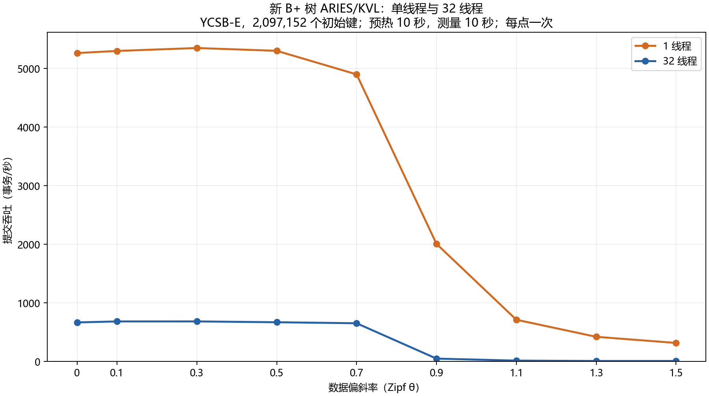

# ARIES/KVL 单线程与 32 线程对比

在 `.66` 上使用相同的 Release 可执行文件运行。单线程九点是本轮新测；32 线程九点使用上一轮保存的实测值，没有重跑或覆盖。每点均只运行一次。

## 参数与可比性

- 相同参数：2,097,152 个初始键、9 个偏斜率、95% 扫描＋5% Insert、每事务 10 次操作、扫描逻辑宽度 32、seed=8、5,000 事务固定请求池、order=128、预热 10s＋测量 10s。
- 使用相同的阻塞等待＋死锁检测，单次锁请求超时 100ms，最多重试 1,000 次，不额外退避。C++ 驱动和核心算法均未修改；只把工作线程由 32 改为 1。
- 每个偏斜率重新装载初始树；预热后的提交插入保留到测量。单线程与 32 线程在预热期间提交的插入数量不同，因此测量开始时树内容和扫描返回行数存在差异。此对比可以观察单线程基线与并发退化，不能作为完全相同静态树上的纯线程扩展率。
- 请求池相同，但线程数改变了请求分片、推进顺序和有限窗口内已完成的请求集合；95/5 是请求生成概率，已提交操作比例会受冲突及运行进度影响。
- 未固定 CPU 亲和性，两轮先后运行；单轮测量不能证明小幅差异的统计显著性。

## 结果

| θ | 单线程 TPS | 32线程 TPS | 32线程/单线程 | 单线程中止 | 32线程中止 |
|---:|---:|---:|---:|---:|---:|
| 0 | 5,265.6 | 664.3 | 0.126 | 0 | 0 |
| 0.1 | 5,301.5 | 681.1 | 0.128 | 0 | 0 |
| 0.3 | 5,351.3 | 681.4 | 0.127 | 0 | 0 |
| 0.5 | 5,303.5 | 667.3 | 0.126 | 0 | 0 |
| 0.7 | 4,901.2 | 650.0 | 0.133 | 0 | 64 |
| 0.9 | 2,005.6 | 46.2 | 0.023 | 0 | 5,823 |
| 1.1 | 710.2 | 12.1 | 0.017 | 0 | 6,056 |
| 1.3 | 418.6 | 5.4 | 0.013 | 0 | 6,940 |
| 1.5 | 313.9 | 5.4 | 0.017 | 0 | 7,543 |

## 实际扫描工作量

返回行数只统计成功提交事务的扫描结果，不含失败尝试已扫描的行数。重复键追加、预热增长和已提交请求组成会影响每事务工作量。

| θ | 单线程平均扫描行/提交事务 | 32线程平均扫描行/提交事务 | 单线程预热后记录数 | 32线程预热后记录数 |
|---:|---:|---:|---:|---:|
| 0 | 309.4 | 304.5 | 2,124,101 | 2,100,540 |
| 0.1 | 309.5 | 304.6 | 2,123,989 | 2,100,604 |
| 0.3 | 310.5 | 304.7 | 2,124,337 | 2,100,584 |
| 0.5 | 321.3 | 305.9 | 2,124,188 | 2,100,545 |
| 0.7 | 523.3 | 330.9 | 2,123,692 | 2,100,427 |
| 0.9 | 2,712.3 | 312.5 | 2,110,993 | 2,097,359 |
| 1.1 | 6,551.1 | 313.4 | 2,102,708 | 2,097,184 |
| 1.3 | 9,372.1 | 317.9 | 2,100,691 | 2,097,156 |
| 1.5 | 11,190.1 | 318.2 | 2,100,116 | 2,097,156 |

## 能确认与尚不能确认的内容

θ=0 时单线程 5,265.6 TPS，32 线程 664.3 TPS，单线程约快 7.9 倍。两轮此点都无死锁或超时中止，提交事务平均扫描行数接近，因此不能把低偏斜下的并发退化解释成大量事务中止。

单线程从 θ=0 到 θ=1.5，平均扫描行数由 309.4 行/提交事务增加到 11,190.1 行/提交事务；吞吐由 5,265.6 降至 313.9 TPS。动态重复插入让热点范围包含越来越多记录，这说明高偏斜下还存在扫描工作量增长；仅凭这些数据不能量化它解释了多少吞吐下降。

单线程测量阶段没有锁等待、死锁或锁超时，排除了其他工作事务造成的锁冲突；驱动逐行计时、游标调用和锁管理器的无竞争操作仍然存在。32 线程的中止数据来自同一核心实现的上一轮实测。

这组对比不能单独证明论文协议有问题，也不能仅凭单线程更快就确定是某个函数调用或某把 mutex 的原因。定位原因还需要调用栈/CPU 与等待时间采样，并控制测量开始时的树内容和实际请求工作量。

全部新测点通过树结构、最终记录数、提交操作数和锁释放校验。CSV 额外保存插入提交数、扫描返回行数、截窗未完成数及重试耗尽数。

## 追溯

- 二进制 SHA256（两轮一致）：`a5c6c7c3593ea69bf96ae1055d91f59e10354f8e9854c3433c657ef666c5984f`。
- 本轮单线程原始目录：`.66:/home/dell/RdmaRangeLock-nextkey-paper-20261117/reports/aries-kvl-ycsbe-20261117-170301`。
- 上轮32线程原始目录：`.66:/home/dell/RdmaRangeLock-nextkey-paper-20261117/reports/aries-kvl-ycsbe-20261117-165236`。
- 单线程重跑命令：`python3 -u scripts/benchmark_aries_kvl_ycsbe.py --threads 1`。
- 所有原始命令、JSON、日志和环境信息均保存在各自目录。目录时间取自远端系统时钟。
