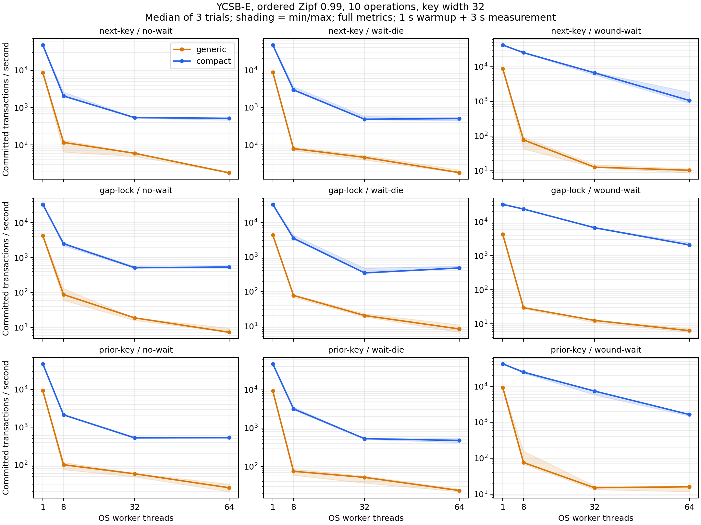

# 三种经典锁的本地 CAS 优化实测（2026-11-13）

机器：10.102.35.66，双路 Xeon Gold 5218，32 物理核 / 64 逻辑 CPU。分支 `codex/record2pl-compact-20261112`。

主实验保留 216 次运行；补充实验保留 72 次运行。以下均为三轮中位数，不以单次最优值作结论。

主实验：项目 YCSB-E，100,000 keys，5,000 条逻辑事务 trace，每事务 10 操作，约 95% 扫描 / 5% Insert，数值区间宽度 32，有序 Zipf 0.99，seed 7。每配置 warmup 1 秒 + 测量 3 秒，OS threads，最多 1,000 次尝试，等待超时 100 ms，full metrics。两后端顺序交错，实验顺序固定随机种子打乱，整机顺序执行。

## 提交吞吐（txn/s）

| 协议 | 策略 | 线程 | generic | compact | 倍率 |
|---|---|---:|---:|---:|---:|
| next-key | no-wait | 1 | 8,687.4 | 47,289.8 | 5.44× |
| next-key | no-wait | 8 | 117.3 | 2,053.5 | 17.51× |
| next-key | no-wait | 32 | 60.3 | 542.2 | 9.00× |
| next-key | no-wait | 64 | 17.9 | 518.4 | 28.88× |
| next-key | wait-die | 1 | 8,709.4 | 46,729.4 | 5.37× |
| next-key | wait-die | 8 | 80.0 | 2,959.7 | 37.00× |
| next-key | wait-die | 32 | 46.6 | 487.2 | 10.45× |
| next-key | wait-die | 64 | 18.3 | 507.1 | 27.73× |
| next-key | wound-wait | 1 | 8,677.0 | 42,116.5 | 4.85× |
| next-key | wound-wait | 8 | 77.3 | 25,376.2 | 328.28× |
| next-key | wound-wait | 32 | 12.6 | 6,650.1 | 525.81× |
| next-key | wound-wait | 64 | 10.3 | 1,061.8 | 102.97× |
| gap-lock | no-wait | 1 | 4,287.2 | 33,478.5 | 7.81× |
| gap-lock | no-wait | 8 | 88.0 | 2,511.8 | 28.56× |
| gap-lock | no-wait | 32 | 19.0 | 515.9 | 27.19× |
| gap-lock | no-wait | 64 | 7.3 | 540.3 | 73.89× |
| gap-lock | wait-die | 1 | 4,288.5 | 33,023.5 | 7.70× |
| gap-lock | wait-die | 8 | 77.3 | 3,461.3 | 44.77× |
| gap-lock | wait-die | 32 | 20.3 | 346.9 | 17.08× |
| gap-lock | wait-die | 64 | 8.3 | 480.6 | 57.85× |
| gap-lock | wound-wait | 1 | 4,278.5 | 32,536.2 | 7.60× |
| gap-lock | wound-wait | 8 | 30.0 | 23,792.4 | 793.27× |
| gap-lock | wound-wait | 32 | 12.6 | 6,714.6 | 531.19× |
| gap-lock | wound-wait | 64 | 6.3 | 2,098.3 | 332.10× |
| prior-key | no-wait | 1 | 9,304.0 | 47,744.1 | 5.13× |
| prior-key | no-wait | 8 | 101.6 | 2,129.1 | 20.95× |
| prior-key | no-wait | 32 | 58.6 | 522.5 | 8.92× |
| prior-key | no-wait | 64 | 24.9 | 531.4 | 21.31× |
| prior-key | wait-die | 1 | 9,298.6 | 47,211.3 | 5.08× |
| prior-key | wait-die | 8 | 74.7 | 3,169.0 | 42.45× |
| prior-key | wait-die | 32 | 51.9 | 529.9 | 10.20× |
| prior-key | wait-die | 64 | 23.6 | 476.1 | 20.17× |
| prior-key | wound-wait | 1 | 9,304.3 | 42,356.2 | 4.55× |
| prior-key | wound-wait | 8 | 75.7 | 24,803.1 | 327.83× |
| prior-key | wound-wait | 32 | 15.0 | 7,387.6 | 492.71× |
| prior-key | wound-wait | 64 | 16.0 | 1,643.8 | 102.96× |

## 高争用与未完成事务

下表为 64 线程；中止、重试和等待时间按各次运行的提交数归一化后取中位数。未完成包含重试耗尽及测量截止仍未完成的逻辑事务，吞吐不能单独代表服务质量。no-wait 的等待时间为 0 不代表没有执行重试开销。

| 协议 | 策略 | 后端 | 中止/提交 | 重试/提交 | 等待 ms/提交 | 未完成 | 重试耗尽 | deadline 中止 |
|---|---|---|---:|---:|---:|---:|---:|---:|
| next-key | no-wait | generic | 183.19 | 181.95 | 0.000 | 71 | 9 | 916 |
| next-key | no-wait | compact | 226.09 | 225.85 | 0.000 | 369 | 305 | 59 |
| next-key | wait-die | generic | 152.96 | 151.71 | 104.600 | 69 | 6 | 1000 |
| next-key | wait-die | compact | 225.30 | 225.05 | 7.005 | 342 | 280 | 154 |
| next-key | wound-wait | generic | 87.13 | 85.06 | 801.052 | 64 | 0 | 689 |
| next-key | wound-wait | compact | 262.46 | 262.32 | 10.299 | 409 | 345 | 175 |
| gap-lock | no-wait | generic | 164.91 | 161.95 | 0.000 | 66 | 2 | 1037 |
| gap-lock | no-wait | compact | 226.62 | 226.38 | 0.000 | 385 | 322 | 60 |
| gap-lock | wait-die | generic | 182.45 | 180.42 | 102.887 | 67 | 3 | 1045 |
| gap-lock | wait-die | compact | 242.85 | 242.59 | 5.403 | 372 | 311 | 124 |
| gap-lock | wound-wait | generic | 82.84 | 79.47 | 733.027 | 64 | 0 | 951 |
| gap-lock | wound-wait | compact | 147.13 | 147.10 | 5.210 | 217 | 153 | 81 |
| prior-key | no-wait | generic | 155.31 | 154.33 | 0.000 | 71 | 8 | 863 |
| prior-key | no-wait | compact | 216.34 | 216.11 | 0.000 | 371 | 308 | 59 |
| prior-key | wait-die | generic | 164.15 | 163.06 | 50.791 | 72 | 9 | 931 |
| prior-key | wait-die | compact | 238.58 | 238.33 | 5.960 | 357 | 294 | 129 |
| prior-key | wound-wait | generic | 45.73 | 44.40 | 542.449 | 64 | 0 | 657 |
| prior-key | wound-wait | compact | 184.24 | 184.17 | 6.954 | 321 | 258 | 134 |

## 一次性初始插入实验

使用全新的索引，去掉 warmup 和 duration，顺序消耗一次 5,000 条 YCSB-E trace，Zipf=0，每事务 10 操作，范围宽 32，32 线程，最多 100 次尝试。seed、数据装载规则与两后端相同。trace 中 Insert key 初始缺失；首次成功提交会填充空洞。同一 trace 内重复 Insert 仍可能命中已存在 key，因此不把所有 Insert 计数当作新物理行。

| 协议 | 策略 | generic txn/s | compact txn/s | 倍率 | generic 未完成 | compact 未完成 |
|---|---|---:|---:|---:|---:|---:|
| next-key | no-wait | 1,360.9 | 38,207.3 | 28.08× | 12 | 0 |
| next-key | wait-die | 1,301.1 | 39,135.1 | 30.08× | 4 | 0 |
| next-key | wound-wait | 1,094.4 | 39,408.9 | 36.01× | 0 | 0 |
| gap-lock | no-wait | 1,592.1 | 39,580.4 | 24.86× | 9 | 0 |
| gap-lock | wait-die | 1,570.0 | 41,910.1 | 26.69× | 11 | 0 |
| gap-lock | wound-wait | 1,408.7 | 39,935.7 | 28.35× | 0 | 0 |
| prior-key | no-wait | 3,817.8 | 41,589.7 | 10.89× | 4 | 0 |
| prior-key | wait-die | 3,693.9 | 39,014.9 | 10.56× | 6 | 0 |
| prior-key | wound-wait | 3,395.7 | 40,818.1 | 12.02× | 0 | 0 |

## 关闭可选计数的性能

仅比较 compact 的 full 与 fast（key-latency=0、key-statistics=0），32 线程、no-wait、有序 Zipf 0.99、warmup 1 秒 + 测量 3 秒；此补充实验 max-attempts=100，与主实验的 1,000 次不同，不混入主实验表。fast 不输出有效的 rows/checksum 和细粒度延迟分布，错误、提交与重试计数仍保留。

| 协议 | full txn/s | fast txn/s | fast/full |
|---|---:|---:|---:|
| next-key | 3,901.3 | 3,732.7 | 0.96× |
| gap-lock | 3,970.1 | 3,818.1 | 0.96× |
| prior-key | 3,823.7 | 3,806.1 | 1.00× |

## 解释边界

- 当前是有限、预注册 key 域的本地实现；未注册 key 的在线扩展尚未实现。预注册不插入数据。
- next/prior 每个原子单元为 8 字节，整个目录共 2N+1 个单元；gap 为 record/guard 两个 N 大小的空间。宽范围需要多个 CAS，仍可能成为瓶颈。
- 连续 key 域目录只存长度，主实验 sparse 目录为 0 字节；锁状态约 1.6 MB，另有 context 和预分配释放数组。generic 空间列未采样，不据此比较内存节省比例。
- 第 64 个 context 的 S 继承 record 的保守 X 编码，会引入额外读读冲突；64 线程结果包含这一限制。
- B+ 树 latch、邻居/key 集重检和数据提交仍保留。移除通用框架开销不能消除真实热点冲突。
- 长时间主实验循环有限 trace，warmup 后部分 Insert 已不是新物理插入；两后端推进量不同，索引填充程度可能不同。一次性实验补充观察真实初始 membership 变化，但负载偏斜与主实验不同。
- rows/checksum 等包含中止尝试；lock_acquires 是逻辑请求数，不是 CAS 次数。两后端并发调度不同，不要求并发 checksum 相同。
- 这些结果描述当前机器、实现和项目负载，曲线按实测绘制，不据文献曲线调整数据。

完整原始结果见本目录 `results.csv`、`summary.csv` 和逐次 stdout/stderr/命令 JSON；机器、源码和二进制 SHA256 见 `metadata.json`。补充结果见相邻 `compact-keys-ycsbe-supplement-20261113` 目录。实现说明见 `../../docs/notes/classic-compact-locks-2026-11-13.md`。
