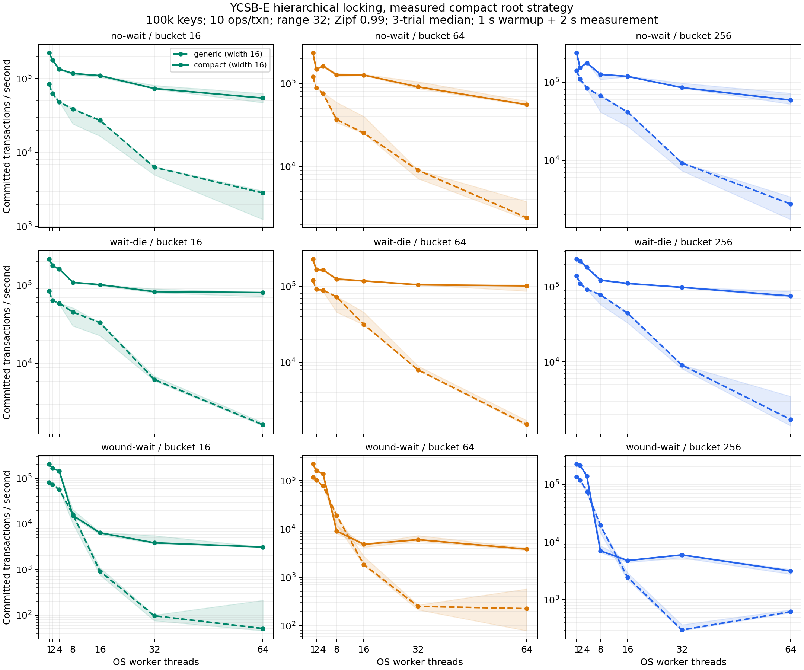

# 固定桶层级锁 CAS 性能结果

机器：10.102.35.66，双路 Xeon Gold 5218，32 物理核 / 64 逻辑 CPU。分支 `codex/record2pl-compact-20261112`。

主实验 378 次，root CAS 对照；root 专项 72 次。每个配置 3 轮，结果取中位数，保留 min/max。

主实验为项目 YCSB-E：100,000 keys，5,000 条有限 trace，每事务 10 操作、扫描宽 32、Zipf 0.99、seed 7；1/2/4/8/16/32/64 OS threads；bucket 16/64/256；no-wait/wait-die/wound-wait；warmup 1 秒，duration 2 秒。Generic 与 compact 运行相同参数，后端交错运行。此持续 trace 会重复访问 key，不能把每个 Insert 当作新物理插入。

主实验显式固定 compact 为 root CAS + dense node word；root 消除和 padding 另作专项对照。此持续 trace 会重复访问 key，不能把每个 Insert 当作新物理插入。

## 宽度 256 的吞吐

| 策略 | 线程 | generic txn/s | compact txn/s | compact root模式 | 倍率 |
|---|---:|---:|---:|---|---:|
| no-wait | 1 | 140,253.0 | 237,579.0 | CAS | 1.69× |
| no-wait | 2 | 109,740.0 | 153,323.0 | CAS | 1.40× |
| no-wait | 4 | 83,941.1 | 177,632.0 | CAS | 2.12× |
| no-wait | 8 | 67,055.5 | 126,021.0 | CAS | 1.88× |
| no-wait | 16 | 41,606.8 | 118,857.0 | CAS | 2.86× |
| no-wait | 32 | 9,246.6 | 85,309.8 | CAS | 9.23× |
| no-wait | 64 | 2,750.5 | 59,068.5 | CAS | 21.48× |
| wait-die | 1 | 140,220.0 | 234,504.0 | CAS | 1.67× |
| wait-die | 2 | 110,652.0 | 220,525.0 | CAS | 1.99× |
| wait-die | 4 | 92,470.6 | 181,949.0 | CAS | 1.97× |
| wait-die | 8 | 78,622.4 | 123,054.0 | CAS | 1.57× |
| wait-die | 16 | 44,706.9 | 111,196.0 | CAS | 2.49× |
| wait-die | 32 | 9,093.4 | 98,627.1 | CAS | 10.85× |
| wait-die | 64 | 1,712.7 | 75,712.9 | CAS | 44.21× |
| wound-wait | 1 | 134,941.0 | 224,704.0 | CAS | 1.67× |
| wound-wait | 2 | 118,348.0 | 213,095.0 | CAS | 1.80× |
| wound-wait | 4 | 74,963.9 | 138,293.0 | CAS | 1.84× |
| wound-wait | 8 | 19,490.9 | 7,040.4 | CAS | 0.36× |
| wound-wait | 16 | 2,464.4 | 4,787.2 | CAS | 1.94× |
| wound-wait | 32 | 300.7 | 5,994.3 | CAS | 19.94× |
| wound-wait | 64 | 622.7 | 3,163.8 | CAS | 5.08× |

## 64 线程重试情况

| 宽度 | 策略 | 后端 | 中止/提交 | 重试/提交 | 等待 ms/提交 | 未完成 | 重试耗尽 | deadline 中止 | CAS 重试/提交 |
|---:|---|---|---:|---:|---:|---:|---:|---:|---:|
| 16 | no-wait | generic | 25.57 | 25.56 | 0.000 | 65 | 3 | 40 | 0.0 |
| 16 | no-wait | compact | 73.26 | 73.23 | 0.000 | 3576 | 3512 | 3 | 208.1 |
| 16 | wait-die | generic | 9.59 | 9.57 | 24.818 | 63 | 0 | 177 | 0.0 |
| 16 | wait-die | compact | 9.04 | 9.04 | 0.558 | 62 | 0 | 59 | 54.6 |
| 16 | wound-wait | generic | 439.81 | 439.02 | 396.623 | 81 | 17 | 581 | 0.0 |
| 16 | wound-wait | compact | 105.77 | 105.75 | 18.158 | 138 | 74 | 64 | 435.9 |
| 64 | no-wait | generic | 24.89 | 24.87 | 0.000 | 64 | 0 | 29 | 0.0 |
| 64 | no-wait | compact | 77.21 | 77.19 | 0.000 | 2608 | 2544 | 7 | 255.0 |
| 64 | wait-die | generic | 10.76 | 10.74 | 28.099 | 63 | 0 | 167 | 0.0 |
| 64 | wait-die | compact | 7.34 | 7.34 | 0.448 | 63 | 0 | 62 | 39.3 |
| 64 | wound-wait | generic | 64.57 | 64.43 | 163.937 | 64 | 0 | 716 | 0.0 |
| 64 | wound-wait | compact | 85.48 | 85.47 | 14.840 | 79 | 15 | 59 | 314.9 |
| 256 | no-wait | generic | 23.21 | 23.20 | 0.000 | 62 | 0 | 22 | 0.0 |
| 256 | no-wait | compact | 68.05 | 68.04 | 0.000 | 1208 | 1147 | 9 | 196.5 |
| 256 | wait-die | generic | 10.45 | 10.44 | 24.258 | 62 | 0 | 158 | 0.0 |
| 256 | wait-die | compact | 11.26 | 11.26 | 0.487 | 63 | 0 | 63 | 105.7 |
| 256 | wound-wait | generic | 3.56 | 3.51 | 91.166 | 64 | 0 | 866 | 0.0 |
| 256 | wound-wait | compact | 94.01 | 93.99 | 18.220 | 111 | 47 | 62 | 370.7 |

## Root CAS 优化

root 专项固定 width=256，对每种策略和 1/8/32/64 threads 将 compact 的 root word CAS 与隐式 IS/IX root 比较，三轮。Generic root 不在此专项重复测试；它在主实验中按原行为执行。

| 策略 | 线程 | root CAS txn/s | implicit root txn/s | 提升 | CAS 重试/提交：root | CAS 重试/提交：implicit |
|---|---:|---:|---:|---:|---:|---:|
| no-wait | 1 | 237,680.0 | 238,197.0 | 1.00× | 0.0 | 0.0 |
| no-wait | 8 | 102,109.0 | 117,315.0 | 1.15× | 33.8 | 0.5 |
| no-wait | 32 | 91,451.5 | 127,897.0 | 1.40× | 70.1 | 2.2 |
| no-wait | 64 | 49,360.4 | 108,764.0 | 2.20× | 301.3 | 4.1 |
| wait-die | 1 | 233,378.0 | 234,507.0 | 1.00× | 0.0 | 0.0 |
| wait-die | 8 | 109,980.0 | 112,671.0 | 1.02× | 6.5 | 1.1 |
| wait-die | 32 | 89,310.7 | 100,488.0 | 1.13× | 33.9 | 2.5 |
| wait-die | 64 | 74,423.2 | 88,058.8 | 1.18× | 112.6 | 3.9 |
| wound-wait | 1 | 224,788.0 | 225,793.0 | 1.00× | 0.0 | 0.0 |
| wound-wait | 8 | 5,921.5 | 1,850.3 | 0.31× | 145.7 | 416.2 |
| wound-wait | 32 | 5,421.4 | 3,670.6 | 0.68× | 179.9 | 198.8 |
| wound-wait | 64 | 2,786.9 | 1,664.6 | 0.60× | 425.5 | 490.8 |

## Padding 与统计开销

width=256、root implicit、32/64 threads、三策略，各配置三轮；padding 直接对比 dense，fast 关闭可选 latency/statistics。

| 策略 | 线程 | dense/full txn/s | padded/full txn/s | padding倍率 | dense/fast txn/s | fast倍率 | node内存倍率 |
|---|---:|---:|---:|---:|---:|---:|---:|
| no-wait | 32 | 137,261.0 | 142,033.0 | 1.03× | 165,787.0 | 1.21× | 8.0× |
| no-wait | 64 | 117,928.0 | 122,466.0 | 1.04× | 167,600.0 | 1.42× | 8.0× |
| wait-die | 32 | 110,719.0 | 116,019.0 | 1.05× | 118,130.0 | 1.07× | 8.0× |
| wait-die | 64 | 100,664.0 | 106,391.0 | 1.06× | 108,168.0 | 1.07× | 8.0× |
| wound-wait | 32 | 4,354.4 | 3,239.2 | 0.74× | 5,402.1 | 1.24× | 8.0× |
| wound-wait | 64 | 1,896.0 | 1,054.2 | 0.56× | 3,280.9 | 1.73× | 8.0× |

## 范围与限制

- Compact 默认省去 intention-only root 的共享 CAS；root 专项仍保留显式 root CAS 对照。该特化只适用于计划中 root 始终为 IS/IX 的固定桶配置。
- 五模式 node authority 是 8 bytes；无竞争的一次获取需要一次成功 CAS。有竞争时 CAS 可重试。wait-die/wound-wait 的冲突路径使用预分配 lease bytes 找到 holder，no-wait 不分配 lease。
- 桶 S 保护范围内的空洞，防止 phantom；桶内 point write 仍为 IX + record X。
- bucket width 会改变冲突粒度；表格按宽度分开报告，不跨宽度宣称锁管理器速度。
- 保留 B+ 树 latch、数据写回、transaction age ticket 和冲突时 lease 扫描。CAS 路径没有消除真实热点上的数据竞争。
- 64-context 所有共享模式通过状态字精确表示，没有把 slot 63 的 S 转为 X。
- 操作、行和 checksum 统计包含已中止尝试；中止/重试/未完成同时列示。generic 的 compact 内存字段为 0 表示未采样。
- 主实验中有一次 generic wound-wait run 触发 lock_errors；原运行保留在逐次日志中。原命令立即重跑成功，summary 用成功重跑值替代失败样本，详见 `retries.json`。
- 原始 CSV、每个 run 的命令和 stdout/stderr、环境与源码快照保存在对应报告目录；ROOT 专项结果在 `../hierarchy-root-ycsbe-20261113`。
- 实现限制和正确性路径见 `../../docs/notes/hierarchy-cas-implementation-2026-11-13.md`。
